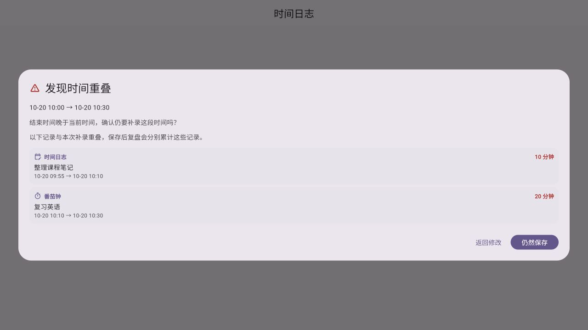

# 第 21 轮验收：专注补录重叠提醒与入口纠正

## 结果

本轮已实现获批方案，自动化验证和正式 Web 构建通过。用户可在补录或编辑时间日志时看到与其他有效时间日志、已完成番茄钟的时间重叠，并自行选择返回修改或继续保存；帮助中心 FAQ 已更正并可直达时间日志补录页。

## 实施内容

- 新增独立重叠检测服务，按左闭右开区间计算，过滤已删除、无效、未结束和未来番茄记录；编辑时排除当前日志。
- 番茄记录按有效专注区间检测：暂停区间会先裁剪、合并并扣除；旧数据没有暂停明细时按完整会话处理。同一番茄记录合并为一条提醒。
- 新增共用保存确认卡片，列出来源、名称、时间范围和重叠时长，最多展示 4 条并说明剩余数量。未来时间与重叠同在时只出现一次确认；“返回修改”不保存，“仍然保存”沿用原保存回调。
- 时间轴拖动新增、补录按钮和已有日志编辑统一经过该检查；不合并、不删除记录，也不更改复盘统计口径。
- 帮助中心 FAQ 改为说明现有补录方式，并增加“前往时间日志”入口。
- 修正时间日志页面窄宽度下日期标题可能挤压导航箭头的问题，文本现在可收缩并省略。

## 验收证据

- `dart format --output=none --set-exit-if-changed`：本轮 8 个 Dart 文件格式检查通过，无待格式化文件。
- `flutter analyze --no-pub`，限定本轮 8 个实现和测试文件：通过，`No issues found!`。
- `flutter test --no-pub test/services/time_log_overlap_service_test.dart test/widgets/time_log_save_confirmation_test.dart test/widgets/settings_navigation_test.dart`：14 项通过。覆盖相邻边界、多个来源和排序、编辑自身排除、删除／无效／未结束数据过滤、暂停区间、跨午夜、少于一分钟重叠、合并未来确认、返回修改／继续保存选择、结果数量限制，以及 FAQ → 时间日志 → 补录入口。
- 导航 widget 测试运行时输出了 `databaseFactory not initialized` 环境告警；测试环境未初始化 `sqflite_common_ffi`，页面使用现有本地回退数据继续渲染，相关路由和入口断言通过。该测试没有验证真实 SQLite 写入。
- `flutter build web --release --no-pub`：通过，生成 `build/web`。构建输出包含 Flutter WASM dry-run 提示和图标 tree-shaking 提示，未阻断构建。
- 另外通过临时 Web 入口加载本轮生产确认组件和合成记录，在浏览器检查了“未来时间 + 时间日志重叠 + 番茄钟重叠”的组合确认界面；截图已保存并嵌入本报告。该图验证组件渲染，不代表真实账户数据或真实保存。

图中本次补录为 10 月 20 日 10:00–10:30：时间日志“整理课程笔记”是 09:55–10:10，与补录相交于 10:00–10:10（10 分钟）；番茄钟“复习英语”是 10:10–10:30，与补录全段重合（20 分钟）。弹窗列出每条记录的完整时间范围和相交时长，没有把相交的局部区间单独着色；因此需按两段时间范围的交集来读。

- 本地浏览器预览成功加载发布版并完成首次引导，到达登录页。进入帮助中心需要账户登录及人机验证；本轮未使用用户凭据，因此未完成真实登录态浏览器流程。帮助中心直达和补录模式由上述 widget 测试验证。

## 未覆盖与边界

- 未在登录态浏览器中手动创建和保存记录；当前预览被登录／人机验证入口阻断，且测试没有初始化 SQLite 驱动。
- 未在原生设备执行交互验收。没有改动任何用户已有时间日志、番茄记录或专注状态。
- 本轮会话无法通过可用工具切换模型或思考强度，因此不声称本次执行使用了用户指定的 GPT‑6 luna／Max。
- 用户已确认验收通过；按约定只提交本轮文件的本地 commit，不 push。
