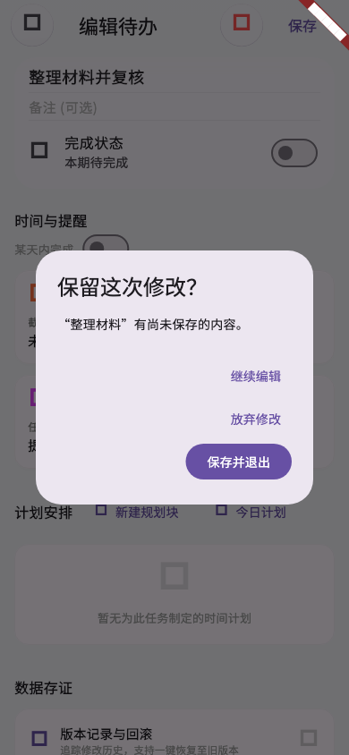

# 第十九轮验收：待办编辑退出保护与保存反馈

日期：2026-10-19（北京时间）

## 结果

第十九轮实现已完成，聚焦回归、静态分析、Web正式构建和差异检查均通过。编辑待办有未保存修改时，系统返回会询问继续编辑、放弃修改或保存并退出；保存失败时留在编辑页并保留输入。保存前会在存储事务内核对编辑基线，旧编辑无法覆盖已变化的待办或文件夹。

## 改动

- `lib/widgets/todo_edit_screen.dart`：编辑对象改为保留原 ID 的独立副本；增加页面退出保护、修改回退判定、提交状态、校验与失败反馈；删除、循环周期编辑和团队文件夹同步与待办保存协调。针对小屏和大字，将时间提醒标题改为可换行布局，并允许日期卡片按内容增高。
- `lib/models/todo_editor_save_result.dart`、`lib/services/todo_editor_save_service.dart`：提供显式待办和文件夹保存结果；对返回不确定的写入按完整快照回读确认。
- `lib/storage_service.dart`、`lib/storage_service_contract.dart`、`lib/storage_service_todos.dart`：显式编辑可传入基线，并在 SQLite 事务中验证待办／文件夹没有被其他操作修改；不改变常规同步写入规则。
- 首页、搜索、待规划清单、规划清理、冲突收件箱和循环待办入口接入同一保存契约。首页会先处理排队中的清单快照，并在显式保存后重新加载待办。
- 新增服务与组件测试；在 `.gitignore` 中为这两个测试文件增加精确例外，避免现有测试目录忽略规则隐藏本轮测试。

## 验收证据

- 聚焦回归命令：

  ```sh
  FLUTTER_ROOT=/private/tmp/cdt-flutter-runtime \
  /Users/junpgle/develop/flutter/bin/cache/dart-sdk/bin/dart \
  --packages=/Users/junpgle/develop/flutter/packages/flutter_tools/.dart_tool/package_config.json \
  /Users/junpgle/develop/flutter/bin/cache/flutter_tools.snapshot test --no-pub \
  test/services/todo_editor_save_service_test.dart \
  test/widgets/todo_edit_exit_protection_test.dart \
  test/widgets/todo_edit_plan_entry_test.dart \
  test/widgets/todo_section_series_visibility_test.dart \
  test/widgets/plan_backlog_screen_test.dart \
  test/widgets/plan_cleanup_screen_test.dart \
  test/widgets/plan_cleanup_flow_test.dart \
  test/services/search_navigation_test.dart \
  test/widgets/settings_global_search_flow_test.dart
  ```

  109 项通过，0 项失败。覆盖保存成功、首次失败后重试、放弃编辑不污染来源对象、旧基线拒绝覆盖、文件夹基线、系统及重复返回、循环副本，以及首页待办卡片和全局搜索两条真实入口。两条入口测试都从实际入口打开编辑器，触发退出保护并执行显式保存，再从合成数据库读回原 ID 对应的更新记录。新增循环结束日裁剪、团队归属在其他位置变化后拒绝旧编辑，以及待办完成信号只在保存成功后发送的回归。规划待办和清理入口也有独立回归。响应式提示测试覆盖 320×640、390×844、844×390、1280×900 和 1.8 倍文字缩放；该用例曾发现两处现有页面溢出，修复后通过。

- 对 25 个相关 Dart 源文件和测试文件运行 `dart analyze`：`No issues found!`
- 正式 Web 构建使用 `FLUTTER_ROOT=/private/tmp/cdt-flutter-runtime` 和 Flutter tools snapshot 的 `build web --release --no-pub`，成功生成 `build/web`。
- `git -c core.fsmonitor=false diff --check` 通过。
- 使用隔离的合成待办额外渲染并检查了 390×844 编辑退出对话框截图，捕获用例通过：

  

## 尚未由本轮证明的范围

另用独立 Edge 会话和新本地来源 `127.0.0.1:8972` 加载 release Web 构建，页面到达应用更新日志首屏；主脚本、SQLite WASM、服务工作线程及页面资源均返回 HTTP 200，浏览器控制台错误／警告列表为空。该浏览器没有登录和合成待办，因此没有在浏览器里进入编辑页。当前已有用户数据的浏览器标签未被操作。

报告中的退出确认截图由 Flutter Widget 测试在隔离环境用合成待办渲染，并非浏览器或真机截图；四种视口和大字状态由响应式 Widget 测试覆盖。Android／iOS 原生返回手势、提醒与多设备同步也未在真机或多个账号间验证。Web 首屏烟测和构建成功不能证明这些运行时行为已经验收。

首页和搜索的实际入口、数据库提交已由 Widget 集成测试覆盖；首页防抖快照在途时序（排队快照被替换、旧写入延迟）、事务提交后副作用故障，以及文件夹先成功而待办后失败的可控故障注入未完成。循环结束日裁剪和团队成员权限变化也没有独立回归用例，因此这些边界仍需后续实测或补充测试。

本轮已通过用户验收并提交为本地功能提交，未推送或发布。工作区中其他规划清理和专注相关修改仍保留。
