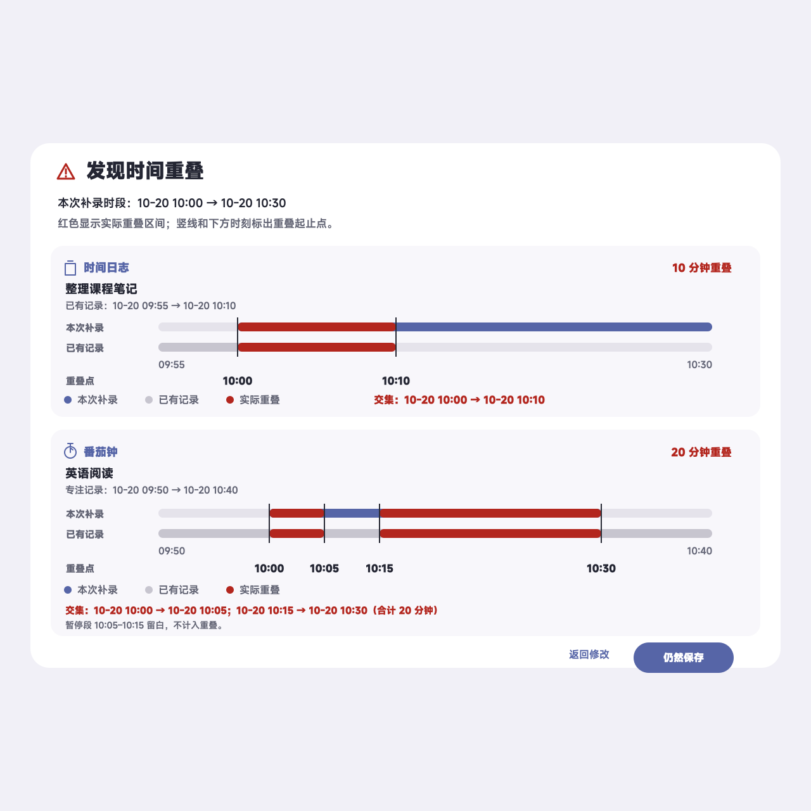

# 第 22 轮验收：补录重叠时段图形化标注

## 验收结果

每条冲突记录现在用同一时间比例绘制“本次补录”和“已有记录”两条轨道。实际交集涂为红色，红色区间的起点和终点在两条轨道上以竖线标出，并在对应位置显示时刻标签。跨午夜时，轨道两端和交集时刻都会同时显示日期与时分；日期和时分分两行排列，靠得较近的交集标签也会自动错行，窄屏下仍能看清关键时刻。

番茄暂停区间从有效专注中扣除后再计算交集。下方示例中的 `10:05–10:15` 暂停段保持空白，两个有效交集分别标出 `10:00–10:05` 和 `10:15–10:30`，合计 20 分钟。具体交集的日期和完整起止文字仍保留，便于精确核对和屏幕阅读器访问。

确认弹窗在桌面最大宽度为 688 px，垂直空间按视口调整。390 px 窄屏跨午夜用例未发现横向溢出；为此，跨日轴端点和交集标签采用分行日期格式。“返回修改／仍然保存”、冲突排序、列表上限及保存行为保持原样。

## 图形证据

下图是使用验收样例生成的矢量对照图，清楚展示红色交集、边界竖线、对齐的时间标签，以及暂停区间留白。实际 Flutter Web 确认弹窗曾在 1280×720 本地浏览器预览中检查；跨午夜标签改为分行后，390 px 窄屏通过 widget 布局测试。最终构建重新打开时进入应用更新说明页，未能再次进入确认弹窗做最终浏览器目视检查。浏览器安全策略也拦截了将浏览器内存截图导出成文件，因此附图是矢量验收图示，不冒充最终版浏览器截图。

可编辑矢量源文件：[2026-10-20-focus-log-overlap-graphical-acceptance.svg](assets/2026-10-20-focus-log-overlap-graphical-acceptance.svg)

## 验收样例

- 本次补录：`10-20 10:00–10:30`。
- 时间日志：`10-20 09:55–10:10`，红色区间为 `10:00–10:10`。
- 番茄钟：`10-20 09:50–10:40`，暂停 `10:05–10:15`；红色区间为 `10:00–10:05` 和 `10:15–10:30`。
- 跨午夜用例：`10-20 23:50–10-21 00:20`，图上分别显示日期和时分：轴边界 `10-20 / 23:50`、`10-21 / 00:20`，以及交集两端 `10-20 / 23:55`、`10-21 / 00:05`。

## 验证

- `flutter test --no-pub test/services/time_log_overlap_service_test.dart test/widgets/time_log_save_confirmation_test.dart`：11 项通过。覆盖半开区间、实际交集区间、番茄暂停切段、窄屏弹窗和跨午夜时间标签。
- `/Users/junpgle/develop/flutter/bin/cache/dart-sdk/bin/dart analyze --fatal-infos lib/services/time_log_overlap_service.dart lib/screens/time_log_save_confirmation.dart test/services/time_log_overlap_service_test.dart test/widgets/time_log_save_confirmation_test.dart`：无问题。
- `flutter build web --no-pub --output /private/tmp/countdowntodo-round22-web-final-2`：应用跨日标签窄屏修复后构建成功。
- 对本轮四个 Dart 文件执行 `git -c core.fsmonitor=false diff --check`：通过。
- 浏览器目视检查：实际 Web 预览中，两类记录均显示边界线和对应时刻；暂停段留白，窄屏视口无溢出。

未运行完整 Flutter 测试套件，也未进行 Android／iOS 真机验收。

## 待办

等待用户验收。通过后只提交第 22 轮方案、报告、图示、服务、弹窗和对应测试文件为一个本地 commit，不 push；其余已有工作区改动保持原样。
