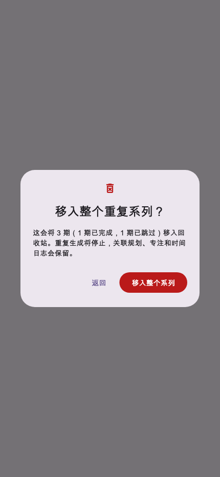
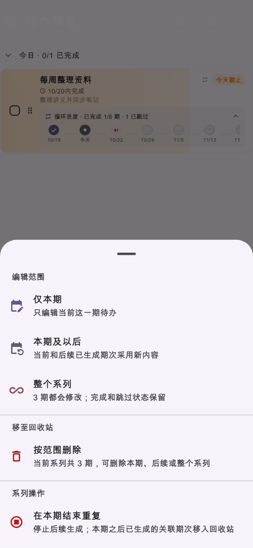

# 第26轮验收报告：重复待办按范围移入回收站

日期：2026-10-20（北京时间）

## 实施结果

- 首页、文件夹和重复待办管理入口共用同一范围选择界面：仅本期、本期及以后、整个系列。每项显示影响期数和已完成／已跳过数量；整个系列需要再次确认。
- 普通待办仍使用原有单条确认。“在本期结束重复”保留为独立操作，并在确认文案中说明当前期和此前期次会保留。
- 删除服务按选中期次的本地日历日规划变更，完整检查系列成员与版本基线，并通过 SQLite 事务一次写入删除和规则转移。保存成功后才更新列表与回收站缓存，失败时保留界面数据并显示原因。
- 仅本期删除规则承载项时，将规则转给后续保留期；本期及以后删除时将规则边界收口到最后保留期；删除整个系列时所有活动记录进入回收站。
- 周期维护保留明确删除的确定性日期墓碑，仅允许本轮维护过程识别的去重墓碑按原修复路径复活。系列读取同时加载活动系列的已删除行，避免维护过程丢失墓碑。
- 没有改动服务端、Cloudflare Worker、规划块、专注或时间日志数据，也没有执行部署。

## 验证

以下 7 组定向测试共 **29 项通过**：

- `flutter test test/services/todo_recurrence_delete_service_test.dart`：4 项通过，覆盖三个删除范围、重复日期、状态统计和规则转移。
- `flutter test test/services/todo_recurrence_delete_storage_test.dart`：3 项通过，覆盖 SQLite 保存、重载后的删除墓碑、后续规则继续、本期及以后边界和整系列删除。
- `flutter test test/services/todo_recurrence_sync_regression_test.dart`：11 项通过。
- `flutter test test/services/todo_recurrence_series_edit_service_test.dart`：3 项通过。
- `flutter test test/widgets/todo_recurrence_delete_dialog_test.dart`：3 项通过，覆盖默认范围、取消不变、整系列二次确认、文件夹滑动入口及两张截图。
- `flutter test test/widgets/todo_recurrence_series_edit_visual_test.dart`：4 项通过，覆盖系列管理菜单新增范围入口、结束重复单独确认，以及窄屏、桌面、深色大字界面回归。
- `flutter test test/widgets/history_and_messages_ui_test.dart --plain-name '恢复回收站待办使用最新记录，避免覆盖并发修改'`：1 项通过，确认回收站仍按最新记录恢复。

本轮相关 Dart 文件的定向 `dart analyze` 无问题。全项目 `flutter analyze` 没有 error 或 warning，但以 6 条既有 info 结束并返回非零：`workbench_view.dart` 1 条、`system_control_service_io.dart` 4 条、`island_ui.dart` 1 条，均不在本轮修改文件中。

`flutter build web --release --no-pub` 成功，耗时约 59 秒。`git diff --check` 通过。SQLite 测试关闭网络同步，因此没有声称完成跨设备或已部署服务端的验证。

## 界面截图

截图由 Flutter Widget 测试在 430×932 手机视口中实际渲染，包含系列管理入口、范围选择和整个系列的最终确认。

## 尚未验证

没有连接 Android／iOS 真机，也没有对云端或另一设备执行实时同步测试；本轮不含部署。当前验收是本地 SQLite、Flutter Widget、Dart 分析和 Web release 构建结果。

验收状态：**等待用户确认**。
