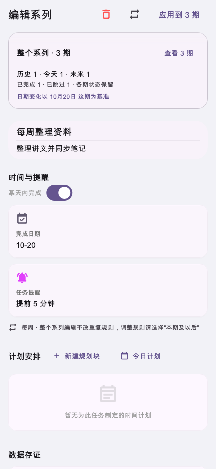
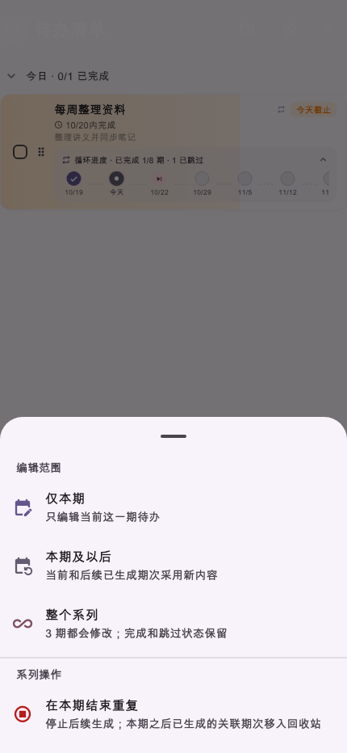
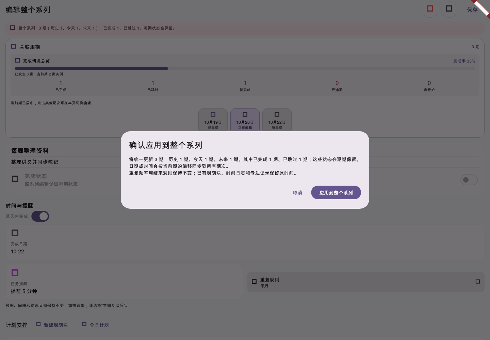
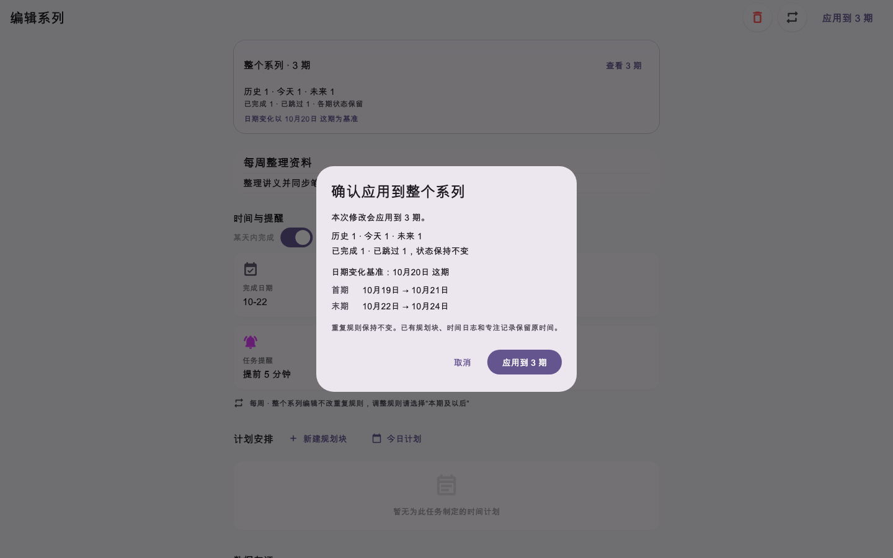
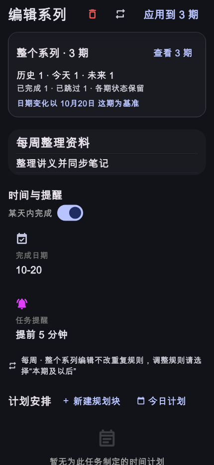

# 第25轮验收报告修正版：重复待办系列编辑与历史保护

状态：**第25轮功能和界面修正版已完成，待用户验收**

## 交付内容

- 在重复待办管理入口增加“编辑整个系列”，并在编辑页和保存确认中列出历史、今天、未来、已完成及已跳过期次数量。
- 整系列编辑只应用标题、备注、日期/时间、分类、提醒和协作信息；保持各期 UUID、系列归属、完成/跳过状态及其同步标记，也保持重复频率、间隔和结束规则。日期变更按同一时间偏移应用到现存期次，并按日历日移动系列结束日期。
- 保存前由本地事务同时校验系列成员集合和每个期次的完整基线。编辑期间新增、删除或修改任一成员时，拒绝整批写入并要求重新打开。
- 已有规划块、时间日志、专注记录及系统日历事件不随待办日期变化。
- AI `update_todo` 只有在用户明确要求整个系列时才能提议 series 范围；执行前显示期次摘要并二次确认。完成、跳过和删除仍不支持 series。
- 同步复用现有逐待办记录与 oplog，不新增 schema、服务端或 Worker 变更。

## UI 修正版补充交付

- 重复待办管理菜单拆成“编辑范围”和“系列操作”两组，减少编辑范围与停止重复操作混在一起的情况；结束重复的说明注明已关联未来期次会移入回收站，现有操作逻辑未改变。
- 整系列编辑页以一张紧凑摘要显示期数、历史/今天/未来分布、完成/跳过状态及日期基准；期次清单默认收起，展开后可查看每一期状态并切换日期基准。
- 隐藏整系列模式下不可用的完成状态开关和重复规则控件，只保留一行重复规则说明。桌面编辑内容限制最大宽度；窄屏和深色大字下缩短页面标题，避免与保存操作挤在一起。
- 保存按钮显示“应用到 N 期”；日期复核明确列出修改期数、首末期变化和当前日期基准。已有保存事务、系列成员保护和各期数据语义保持不变。
- 视觉测试关闭 Flutter 调试角标并显式加载 Material 图标字体，确保截图展示实际图标。

## 验证结果

- **系列相关定向测试**：运行 86 项，85 项通过。覆盖成员范围与计数、事务基线与成员集合保护、AI 明确范围解析和执行、单期状态保留、编辑器二次确认与退出保护、三种屏幕截图。
- **失败测试 1 项**：`AI fixed schedule alignment planning context injects fixed schedules as hard constraints` 断言“明天10点开项目会议”应自动注入 `create_schedule`。该测试在本轮代码临时替换为仓库 HEAD 版本后仍以相同断言失败；本轮没有改动固定日程显式动作识别逻辑。
- **另一次 AI 规划集成测试**：`规划文字假成功补发工具请求，显示4张真实操作并只在点击后保存` 在 `history.last.todoActions` 处失败。将 AI 解析、执行、提示和动作 UI 文件暂时恢复到 HEAD 后同样失败；底层原因不属于本轮系列编辑，本轮没有修改其失败行为。为保持当前新增的可选并发保护参数可编译，仅更新了该测试回调签名。
- **静态分析**：本轮全部 Dart 改动路径 `dart analyze` 通过，无问题。全项目 Flutter analyzer 无错误；报告了 6 条 info 级提示，均位于本轮之外已有工作区改动的 `workbench_view.dart`、`system_control_service_io.dart` 和 `island_ui.dart`。
- **Web 构建**：`flutter_tools.dart build web --release --no-pub` 成功。
- **视觉检查**：3 项真实 `TodoEditScreen` Widget 渲染截图测试通过，使用合成的历史、当前、未来期次；没有使用或修改个人账户数据。当前未执行真实浏览器登录后保存流程、原生设备验证或跨设备服务器同步验证。
- **代码差异**：本轮未改动数据库 schema、服务端、Cloudflare Worker、部署配置或版本号。

## UI 修正版补充验收

- **定向回归**：`todo_recurrence_series_edit_visual_test.dart` 与 `todo_edit_exit_protection_test.dart` 共 19 项全部通过，覆盖菜单分组、期次明细展开/收起、日期基准切换提示、首末期日期变化、取消和整批保存、保存失败及退出保护。
- **视觉截图**：窄屏编辑器（430×932）、桌面日期复核（1440×900）和深色大字编辑器（430×932，1.35 倍）通过 golden 对比；重复管理菜单由集成 Widget 流程实际打开并截图（430×932），逐张检查了图标、标题、范围、按钮和信息层级。菜单标签和分组另由测试断言。截图只使用合成的历史/当前/未来待办，不含个人账户数据。
- **Dart 静态分析**：本次涉及的两个 UI 文件和两个测试文件 `dart analyze` 无问题。
- **Web release 构建**：`build web --release --no-pub` 成功。
- **未验证范围**：未用真实账户运行 Web 端保存流程，也未做原生设备、跨设备同步或部署验证。截图证明 Widget 实际渲染与布局，不替代这些验证。

## 界面证据：修正前与修正后

截图由 Flutter WidgetTester 渲染实际页面，配合 CJK 与 Material 图标字体和合成数据生成。修改前截图保留旧版重复信息、调试角标和测试环境中的方框图标；这些图标占位不代表正式运行版资源。

### 窄屏编辑器（430×932）

修改前：

修改后：

### 重复管理菜单

### 桌面日期变更确认（1440×900）

修改前：

修改后：

### 深色与大字

修改前的深色大字截图：[打开图片](assets/2026-10-20-series-edit-before-dark-large-text.png)

## 环境与流程说明

当前会话没有切换或核验模型名称及思考强度的能力，因此不能声称规划使用 GPT‑6.1 sol／中、实现使用 GPT‑6 luna／Max；实际使用的是当前会话分配的模型。完整 `flutter test`、真实浏览器端到端流程、原生设备和多设备同步均未执行。

本报告、截图和 UI 修正版随本地 follow-up commit 提交；不推送、不部署、不发布。
