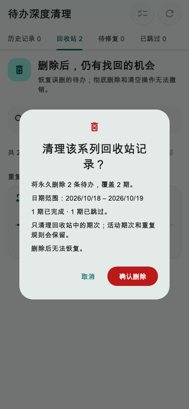
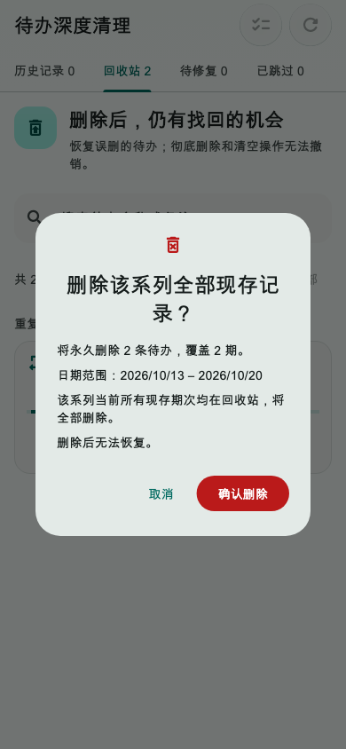
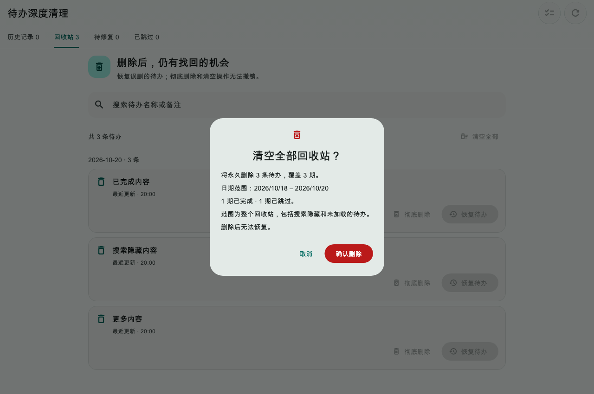
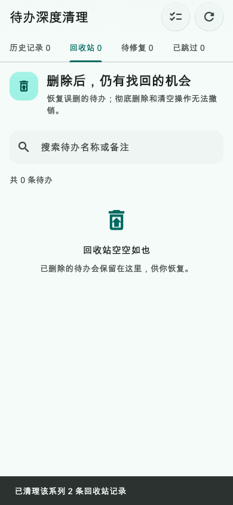

# 第28轮验收：回收站系列清理与彻底删除保护

日期：2026-10-20（北京时间）
状态：**验收通过（2026-10-21）**

## 交付内容

- 回收站重复系列卡片新增“更多”菜单，可清理该系列当前仍在回收站的记录。部分删除系列会明确保留活动期次和重复规则；全组均在回收站时，会说明全部现存记录都将被删除。
- 单条、系列和清空全部操作在确认前从 SQLite 读取完整预览，显示记录数、期数、日期范围以及完成／跳过状态。清空范围包含被搜索隐藏和分页未加载的记录。
- 确认后在同一 SQLite 事务内复核目标成员集合、版本、更新时间与回收站状态；待办行删除和逐条 DELETE oplog 原子提交。确认期间记录有变化或任一 oplog 写入失败时整笔回滚。
- 数据库提交后清理本机待办镜像、刷新关联日期的日程冲突并触发现有待办刷新。重复期次物理删除后保留 DELETE oplog 作为生成抑制标记，并清除当日重复维护缓存，避免后续维护重建同一确定性 UUID。后置刷新失败会在成功提示中明确标出，不将已提交的数据库操作误报为回滚。
- 不修改服务端、数据库 schema、重复规则权限；规划、专注、时间日志、日历副本和附件不属于本轮物理删除范围。

## 验收证据

新增的 8 项 SQLite 存储测试、4 项界面测试通过，覆盖完整与部分系列、精确清空范围、单条恢复后的过期确认、新增系列成员后的过期计划、循环期次防复活以及 oplog 故障回滚。另有 32 项既有回收站／历史页面回归通过，总计 44 项相关测试通过。

| 检查 | 结果 |
| --- | --- |
| `flutter test --no-pub test/services/todo_trash_purge_storage_test.dart` | 8 项通过 |
| `flutter test --no-pub test/widgets/todo_trash_purge_flow_test.dart` | 4 项通过 |
| 重复待办删除存储回归 | 3 项通过 |
| 重复待办整组恢复存储回归 | 3 项通过 |
| 回收站整组恢复页面回归与截图 | 3 项通过；新增菜单后更新两张对应截图并复验 |
| 历史待办与消息页面回归 | 23 项通过 |
| 涉及本轮的 9 个 Dart 源码／测试文件静态分析 | 无问题 |
| 全项目 `flutter analyze --no-pub` | 命令以 6 条 info 退出；本轮文件无问题，提示位于未改的专注视图、系统控制和 Windows Island 文件 |
| `flutter build web --release --no-pub` | 成功，产物位于 `build/web` |
| 本轮文件 `git diff --check` | 通过 |

界面证据来自 Flutter Widget 测试截图，覆盖手机部分删除确认、手机全系列确认、桌面清空确认和手机删除成功状态；另在 360×800、深色和 1.35 倍字号下检查布局无异常。未在真实 Android／macOS 设备上验证，也未验证云端或第二台设备收到 oplog。

### 手机：部分删除系列

### 手机：完整系列

### 桌面：清空回收站

### 手机：清理成功

## 提交范围

第28轮实现与验收已通过。实现 commit：`a60f7be7`。本次仅更新验收状态与日期，随后单独提交这两份第28轮文档；规划、习惯、专注、版本文件及其他既有工作区改动不纳入。提交本地 commit，不推送、不部署。
