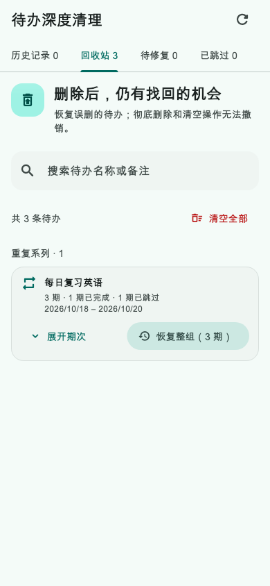
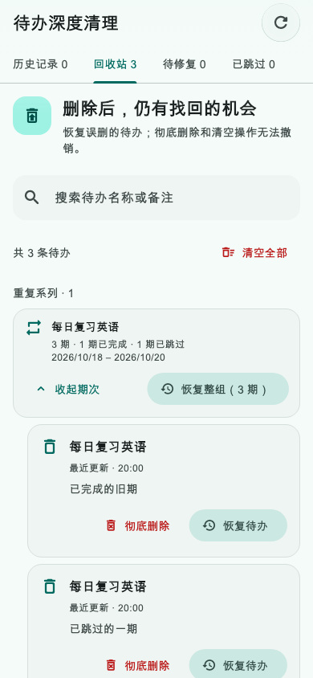
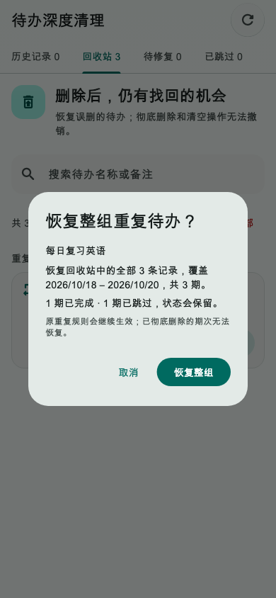
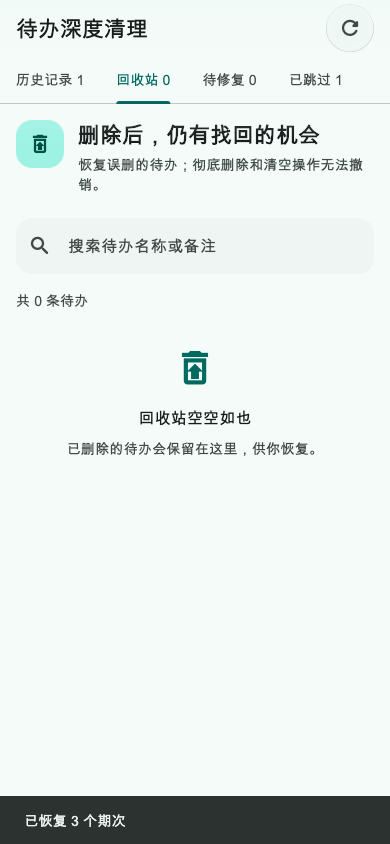

# 第27轮验收：回收站重复待办整组恢复

日期：2026-10-20（北京时间）

状态：**用户确认验收通过**

## 交付行为

- 回收站按重复系列折叠展示，并列出期数、日期范围、完成数和跳过数；展开后仍能逐期恢复。
- 仅当全部现存系列成员都已删除、至少覆盖两个日期、且只有一个规则承载项时，提供“恢复整组”。部分删除、规则不明确或数据状态无效时保留逐期操作。
- 确认页显示恢复条数、期数、日期范围和完成／跳过状态。恢复保留这些状态和原重复规则；失效文件夹按单条恢复规则改为未分组。
- 保存前重新读取数据，并在 SQLite 事务内校验全系列成员集合、删除状态和版本基线；并发变化时整组拒绝，不会部分恢复。成功后清理对应的本地周期去重墓碑。
- 分页回收站读取会补齐已删除规则承载项所在的完整系列，恢复完成后刷新列表并显示成功反馈。

## 验收结果

- 定向回归：44项通过，覆盖整组计划、事务和并发、超过一页的系列补齐、原有重复删除、单条恢复、历史与回收站页面及手机深色大字布局。
- 本轮涉及的8个 Dart 文件：`dart analyze` 无问题；格式检查通过，`git diff --check` 通过。
- 全项目 `dart analyze` 没有错误，报告6条位于本轮以外文件的 `info` 提示。
- `flutter build web --release --no-pub` 成功。
- 单独复跑 `todo_recurrence_series_edit_visual_test.dart` 中“重复管理菜单区分编辑范围和系列操作并保留期数信息”时，仍有一个既有黄金图比较失败（4.49%，18,002像素）。该测试与黄金图未被本轮修改，测试画面是 TodoSectionWidget 的重复管理菜单，不涉及回收站整组恢复；原因尚未定位，本轮没有改写该黄金图。
- 截图来自手机尺寸 Flutter Widget 测试（390×844），包括折叠摘要、展开期次、确认界面和恢复成功后的空回收站及提示条。没有执行实体手机或真实浏览器手工操作。

## 界面证据

### 回收站折叠摘要

### 展开期次与逐条入口

### 整组恢复确认

### 恢复完成

本轮提交范围仅包括方案、验收记录、整组恢复实现、对应测试和截图，以及将这些测试与截图纳入版本控制的 `.gitignore` 例外规则。没有推送或部署。
