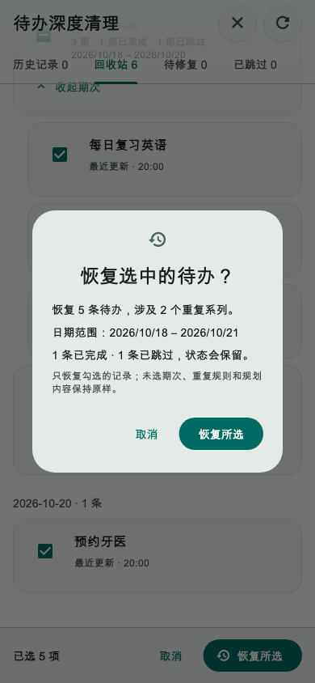
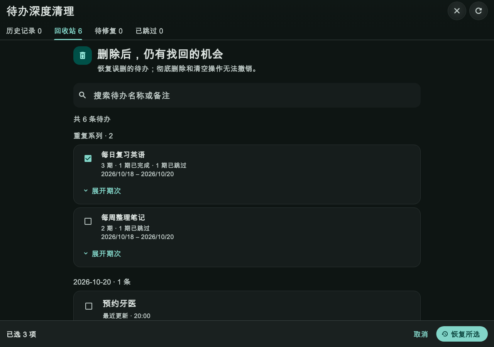
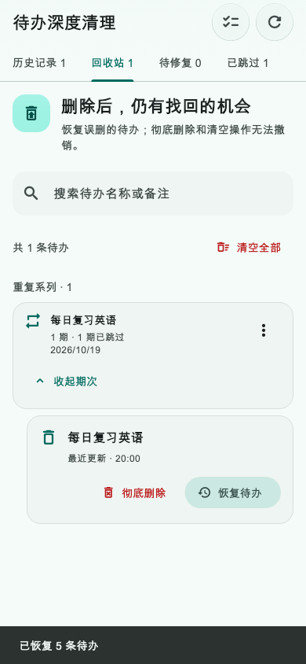

# 第29轮验收：回收站跨系列多选恢复

日期：2026-10-21（北京时间）

状态：**待用户确认验收**

实现提交：`4a9e0297`（`v7.1.7 【优化】回收站跨系列多选恢复`）

## 交付行为

- 回收站提供临时多选模式，普通待办可逐条选择；重复系列可一次选择当前回收站中的所有期次，也可展开后选择单期。选择可跨系列、搜索结果和已加载分页累积，退出回收站或选择模式会清空临时选择。
- 系列复选框表达全选／部分选择／未选择；系列操作会读取完整本地系列成员。分页尚未完整加载时，部分选择不会被误报为全系列已选。
- 底部安全区操作条持续显示准确数量；确认摘要展示待办数、系列数、日期范围和完成／跳过数量。完成状态、跳过状态、重复规则及规划内容保持不变；仅恢复所选记录。
- 存储层通过 `saveTodos` 在本地事务内校验全部版本基线并写入待办与 oplog。任何所选项并发变化都会整批拒绝。成功后仅清除选中重复期次的本地去重墓碑；成功刷新回收站并显示恢复数量。
- 系列读取延迟期间若用户离开回收站，迟到结果不会重新填入已取消的选择；新增 Widget 测试覆盖该状态竞态。

## 验收结果

- 新增服务、SQLite 存储和 Widget 测试共 **8项全部通过**：跨普通待办及多个系列、部分选择与系列三态、原完成／跳过状态保留、每条待办写入本地 oplog、并发基线失效时整批不恢复、选择页面交互和延迟结果边界。
- 本轮涉及的7个 Dart 文件定向 `flutter analyze --no-pub` 通过：无问题。
- 本轮新增服务和测试已运行 `dart format`；`git diff --check` 和 staged diff 检查通过。
- 回收站整组恢复服务与存储回归共8项通过。混合回归中，`todo_trash_purge_storage_test.dart` 有7项通过、1项失败：既有用例“部分删除系列只清理墓碑，活动期次与规则保留”期望 `RecurrenceType.daily`，实际得到 `RecurrenceType.none`。该测试属于回收站清理／重复规则边界；共享存储文件在本轮前已有未提交的重复截止边界改动，未将此失败归因于本轮多选恢复。
- 混合回归中的三个既有 Widget 测试和 `flutter build web --release --no-pub` 均被同一处编译错误阻断：未修改文件 `lib/features/finance/widgets/finance_widgets.dart:2005:54` 将 `String?` 传入 `String` 列表。本轮没有改动该财务代码，也没有因此宣称 Web 构建通过。
- 没有在实体手机或浏览器中手工操作；以下图片来自通过的 Flutter Widget 黄金测试，分别覆盖手机确认、桌面深色大字选择状态和恢复成功。

## 图片证据

### 手机：恢复确认摘要

### 桌面：深色大字系列多选

### 手机：恢复成功反馈

## 提交范围

本地实现提交为 `4a9e0297`；本验收报告另作文档提交。未推送或部署。其他已有工作区改动保持未暂存。
