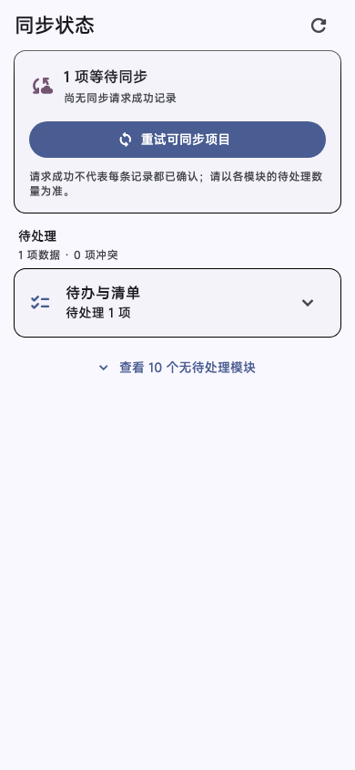
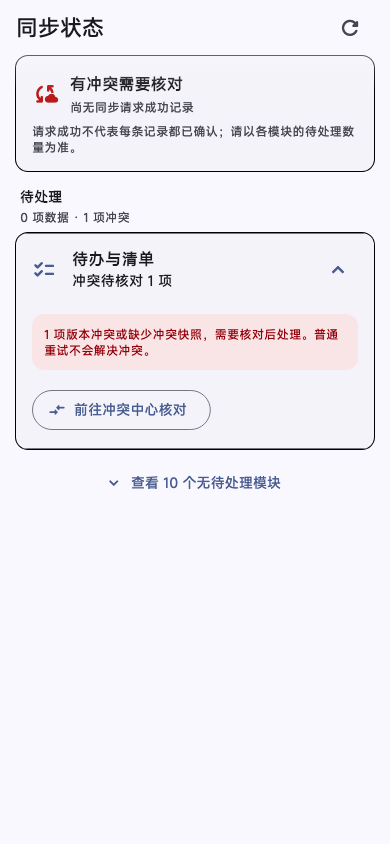
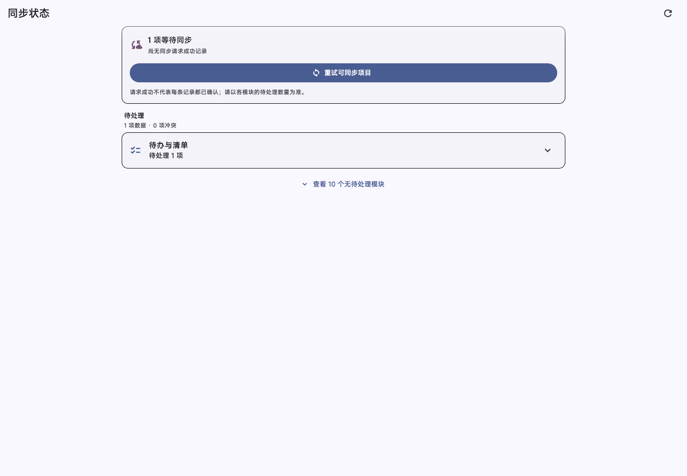

# 第30轮验收：同步状态总览与按模块安全重试

日期：2026-10-21（北京时间）

## 实现结果

- 设置页新增“同步状态”，显示当前账户、最近同步请求成功时间、待上传数量、失败和冲突，并按业务模块查看明细。
- 关于页的同步提示改为摘要入口，完整状态集中在同步状态页。
- 普通待上传和可重试失败可按模块进行增量同步；冲突只提供现有冲突处理入口。记账重试尊重原有云同步设置，屏幕时间使用现有单独同步链路。
- 页面请求和重试前后检查账户身份，异步加载失败或账号切换时不会用旧账户快照覆盖当前页面；错误摘要做长度限制并隐藏凭据样式文本。
- 修复 screen-time-only 增量调用被通用空同步保护提前拦截的问题。服务端返回 `success: false` 时现会被识别为失败，保留待同步数据且不推进成功时间。

## 界面证据

以下截图来自本轮 Flutter Widget 测试所用页面和本机数据夹具，分别覆盖手机待上传、手机冲突与桌面布局。

### 手机：待上传状态

### 手机：冲突状态

### 桌面：待上传状态

## 验证结果

- 定向回归：30 项通过，覆盖队列聚合、冲突排除重试、记账隐私开关、账户隔离、屏幕时间单独重试、服务端拒绝后的数据保留，以及页面窄屏／桌面／深色大字布局。
- 静态分析：8 个本轮 Dart 源码及测试文件通过，`flutter analyze --no-pub ...` 无问题。
- Web 发布构建：`flutter build web --release --no-pub` 成功。
- 全量测试：`flutter test --no-pub --reporter compact` 结束，3,110 项通过、5 项跳过、12 项失败，退出码 1。失败集中在当前工作区其它财务和规划界面测试，日志包含 `databaseFactory not initialized` 以及财务界面文本数量断言失败。本轮不涉及这些界面的展示逻辑；工作区本身还包含未提交的财务和规划相关改动，因此不能据此断言它们在干净基线上的表现。
- 全量测试结束后尝试单独复跑两项财务同步刷新测试，但 Flutter 启动阶段无法写 SDK 引擎缓存（`Operation not permitted`），因此未得到复跑结果。没有删除测试。
- 本轮 Web 构建及界面截图不代表已连接真实账户或线上服务验证；重试行为由本地数据库和 loopback HTTP 测试覆盖。

## 验收结论

同步状态功能本身的定向测试、静态分析和 Web 构建通过。全量测试仍有 12 项失败，原因尚未逐一在独立运行中确认；请结合上方结果决定本轮是否通过验收。

## 截图文件

- `assets/sync-health-center/pending-phone.png`（390 × 844）
- `assets/sync-health-center/conflict-phone.png`（390 × 844）
- `assets/sync-health-center/pending-desktop.png`（1440 × 1000）
