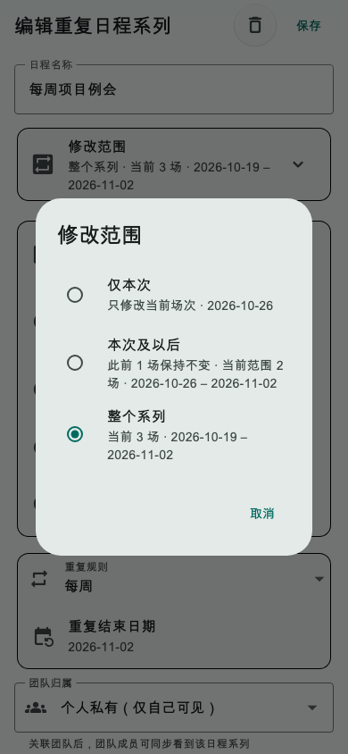
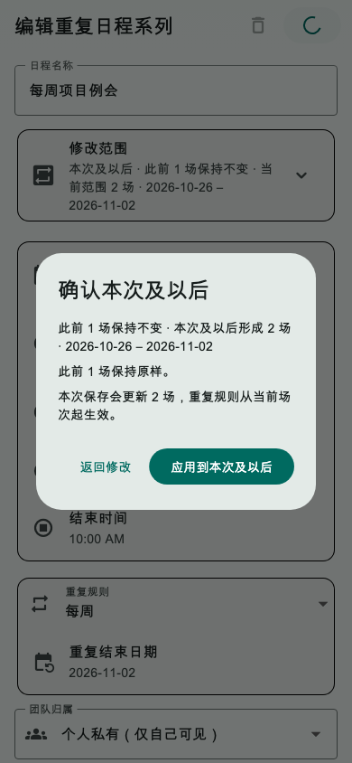
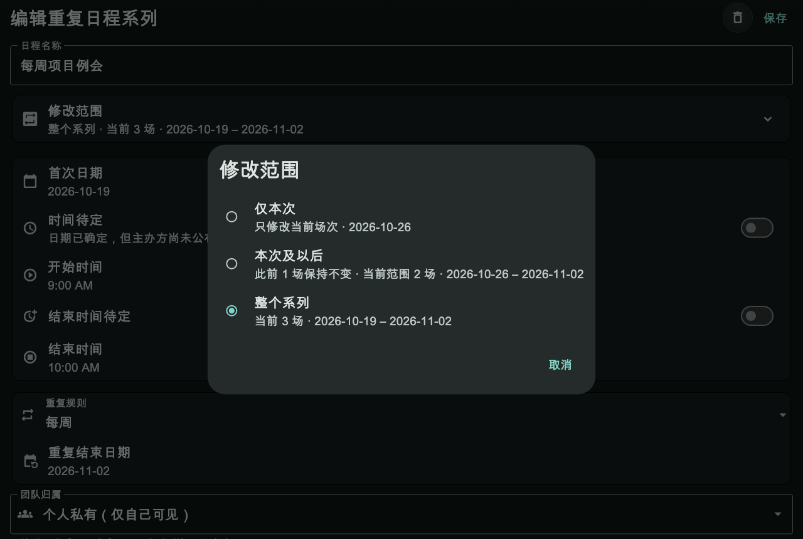
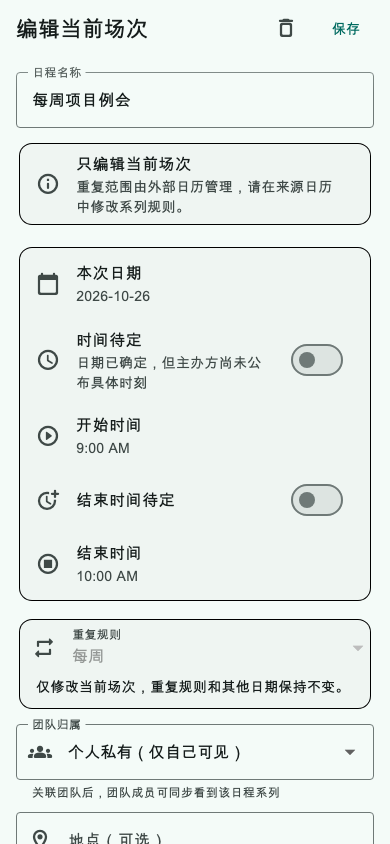

# 第32轮验收报告：固定日程重复范围编辑

状态：**实现和内部验收完成，等待用户确认**

## 实施结果

- 应用内重复固定日程支持“仅本次”“本次及以后”“整个系列”三种修改范围，默认整组；选择器和保存确认分别显示当前场次、保留场次数、结果场次数及日期范围。
- 仅本次编辑保留其他场次与重复规则。将日期移出原场次时，原 UUID 留在原系列并标记取消，新日期新增独立日程；新记录不继承外部日历事件 ID。
- 本次及以后以当前场次 UUID 为新系列根，历史场次保持原数据。整个系列按新规则重建；已有期次保留 UUID、状态、来源、关联待办、外部身份和创建信息，新增日期使用新 UUID，移除日期写入逻辑删除。
- 取消状态只改当前场次；团队归属只有在用户有权限且主动更改时才应用于受影响范围。
- 手机日历或导入来源控制的重复日程只允许编辑当前场次；重复规则和日期锁定，界面提示去来源日历改系列。路由传入的数据若已过期，表单先读取本地数据库最新实例再允许编辑。
- 保存事务核对编辑器读取的记录快照、系列成员集合和新增 UUID 是否已被占用；发现期间更新时整批拒绝。通过时固定日程行和对应 oplog 在同一 SQLite 事务中写入。
- 更新固定日程产品语义文档。未增加数据库字段、服务端接口或能力版本，未修改 CDT-server、Cloudflare Worker、提醒、规划块、专注、时间日志或待办完成状态。

## 验证

- 固定日程、系列编辑与存储、重复规则、冲突、AI 固定日程、备份导入、系统日历、模型、详情页和新编辑器截图回归：**107 项全部通过**。
- 本轮 10 个 Dart 源码与测试文件的定向 `flutter analyze`：**无问题**。
- `flutter build web --release --no-pub`：**成功**。
- 全仓 `flutter analyze` 仍被三个未修改的习惯测试错误阻断：`test/features/habits/habit_celebration_test.dart` 第 134、161、263 行引用未定义的 `HabitCelebrationTrigger`。另有一个未修改的 `lib/windows_island/island_ui.dart:5` `unnecessary_import` 信息。本轮没有改动或删除这些既有测试。
- 视觉测试使用合成系列数据和 Flutter WidgetTester 实际渲染；手机、桌面深色大字、旧路由数据刷新、外部日历当前场次锁定共 4 项通过。截图不是示意图。
- 未运行全仓 `flutter test`，未登录真实账户执行浏览器保存流程，未做真机或跨设备云端同步测试；构建和本地 SQLite 测试不代表这些验证。

## 界面证据

截图由 Flutter WidgetTester 在真实编辑器 Widget 中生成，使用合成数据，不含个人账户信息。

### 手机范围选择

### 手机保存复核

### 桌面深色与大字

### 外部日历管理的当前场次

## 模型执行说明

你要求方案使用 GPT-6.1 sol／中、实现使用 GPT-6 luna／Max。当前会话没有模型切换或核验入口，因此我不能声称本轮按指定模型与思考强度执行；实际运行的是当前会话分配的模型。

本轮将按当前版本前缀提交本地 commit，不推送、不部署、不发布。用户确认验收后再准备第33轮方案。
