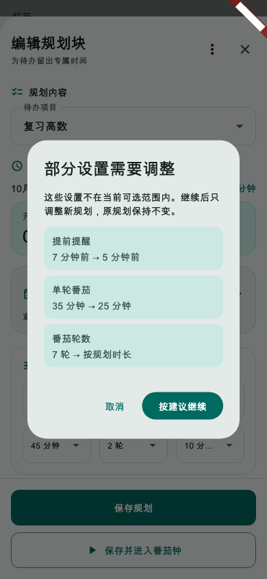
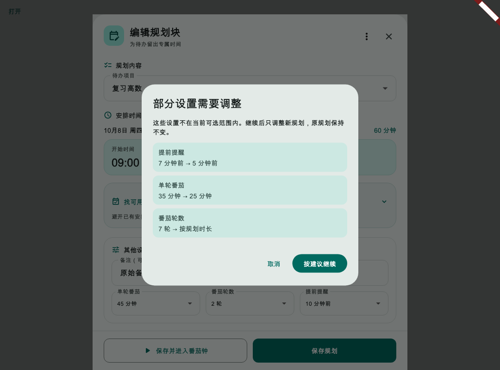

# 第31轮验收：规划复用设置兼容与明确修复

日期：2026-10-22（北京时间）

状态：实现完成，等待用户验收

## 实现结果

- “照此新建”遇到当前选项不支持的提醒、单轮番茄或轮数时，保留受支持项，只把受影响项替换为安全默认值：提醒5分钟、单轮番茄25分钟、轮数0（按规划时长）。
- 替换前先逐项显示原值和新值；取消不产生规划、草稿或操作日志。确认后进入新的整页编辑，顶部继续显示调整明细，来源规划保持不变。
- “重新安排漏做规划”共用相同修复规则，分别说明每一项仅应用于新规划。
- 调整说明随现有本机草稿保存；旧草稿仍兼容，不增加数据库列、迁移或同步字段。
- 结构无效、来源冲突、待办状态变化、账户变化和保存时复核保持原有防护。

## 界面证据

手机确认弹窗：

桌面确认弹窗：

深色模式与大字号：

## 验证

- 设置策略、复用服务、漏做恢复、草稿持久化及编辑器交互相关的定向回归：85项通过。
- 规划复用 Widget 测试及手机、桌面、深色大字号三张 Golden 截图：23项通过。
- 本轮11个 Dart 源码和测试文件静态分析：无问题。
- Flutter Web Release 构建：通过。
- `git diff --check`：通过。
- 全量 Flutter 测试：3122项通过、5项跳过、10项失败。失败位置都在本轮未修改的测试文件：
  - 习惯：`test/features/habits/habit_celebration_test.dart` 找不到“打卡 30分钟”。
  - 财务：`test/features/finance/finance_management_screens_test.dart` 中，未来账单测试找到两处“净支出 ¥15.00”，删除分类历史账单测试缺少预期标签。
  - 日期／DST：`test/utils/time_log_range_math_test.dart`、`test/utils/calendar_date_math_test.dart`、`test/services/search_date_query_dst_test.dart`、`test/services/personal_timeline_date_range_test.dart`（2项）和 `test/services/timeline_finance_dst_test.dart`（2项）共7项，实际时长与预期相差1小时（预期23/25/47/167小时，实际24/24/48/168小时）。
  - 这些失败不涉及本轮规划复用或漏做恢复代码；本轮相关定向测试及全量回归中的规划测试均通过。

## 提交范围

本轮仅提交规划设置兼容、漏做恢复提示、规划编辑器与草稿说明、相关测试和三张验收截图；不推送、不部署。
