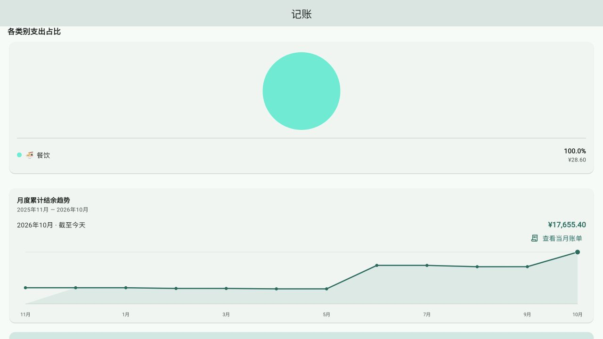
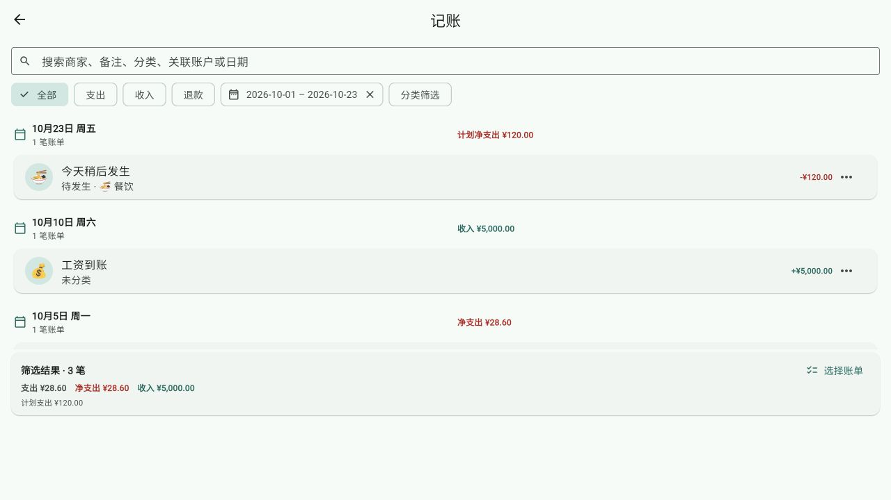

# 第36轮验收：月度结余趋势直达账单

日期：2026-10-23（北京时间）
状态：**实施与技术验收完成**

## 结果

月度累计结余趋势的选中月份旁新增「查看当月账单」。入口打开隔离的账单页：历史月份显示完整自然月，当月显示月初至今天；不添加分类或收支类型筛选。点击普通趋势点仍只切换月份；从账单页返回后保留原趋势选中月份。

账单页复用既有查询、明细与待发生标记。趋势只累计截至当前时刻已发生的金额，当日计划账单可在账单页出现并继续显示「待发生」。无流水的历史月份仍显示准确日期范围和空状态。

## 截图证据

以下页面使用本地预览中的合成流水，不读取个人财务数据。浏览器截图尺寸为 1280×720；本轮没有连接真机。窄屏、深色和大字布局另由 320×720 Widget 测试覆盖。

## 验收覆盖

- 趋势入口传入当前选中数据点的年月；按钮使用来源锚点，可继续沿用页面转场。
- 历史月份打开完整月范围，无分类或类型附加筛选；返回后保留原趋势月份；切换并再次进入其他月份使用新范围；空月份显示日期范围与空状态。
- 当前月份范围截至今天，并保留今天稍后发生的计划账单及「待发生」状态。
- 深色主题、大字号与窄屏（320×720、1.4 倍文字）下趋势保持可见、可滚动和可点击。

## 验证结果

- 财务回归：`flutter test --no-pub test/features/finance/ test/features/finance_cumulative_balance_trend_test.dart test/widgets/finance_transaction_detail_screen_test.dart`，**645 passed，5 skipped**。
- 财务管理页测试：`flutter test --no-pub test/features/finance/finance_management_screens_test.dart`，**132 passed，3 skipped**。
- 趋势测试：`flutter test --no-pub test/features/finance_cumulative_balance_trend_test.dart`，**7 passed**；包含窄屏深色大字布局。
- 受影响文件静态分析：`flutter analyze --no-pub lib/features/finance/screens/finance_home_screen.dart lib/features/finance/widgets/finance_widgets.dart test/features/finance/finance_management_screens_test.dart test/features/finance_cumulative_balance_trend_test.dart`，通过，无问题。
- Dart 格式检查及 `git diff --check` 通过。
- `flutter build web --release --no-pub` 通过。临时预览构建完成后已重新运行正式 Web 构建。
- 本地浏览器手动检查通过：趋势入口打开 2026 年 10 月账单（范围 10 月 1 日至 23 日），能看到计划中的待发生项目；返回后继续显示原趋势上下文。截图采用合成数据。

未进行真机安装或设备验收。当前执行环境不提供切换或核验模型/思考强度的能力，因此无法确认实现阶段使用 GPT‑6 luna／Max；这一限制不影响上述代码与测试结果。

## 提交

本轮实现、测试、提案状态更新、验收报告和截图作为一个本地 commit 提交；不推送、不发布。
