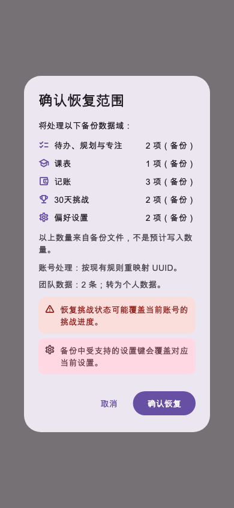
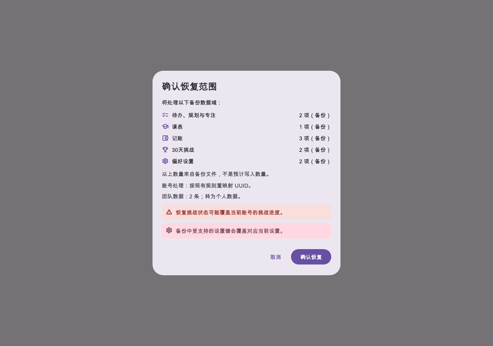
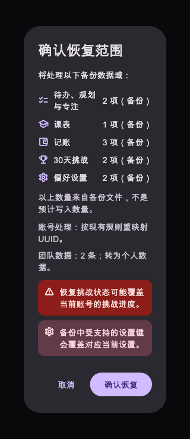

# 第46轮验收：数据恢复规则复核与分域结果回执

日期：2026-10-24（北京时间）

状态：**用户验收通过；按本轮清单提交。**

## 完成内容

- 团队数据计数现在只统计所选范围内、确实会使用团队策略的数据段；规划区块和番茄记录等不再误计。
- 导入规则卡移除“一种合并规则适用于所有数据”的承诺，说明备份计数的含义，并按选择显示挑战进度和偏好设置覆盖提醒。
- 写入前增加确认弹窗，列出本次选择的数据域和备份文件条目数、UUID 处理、团队记录与策略；取消不会进入导入调用。
- `ImportResult` 保留旧全局计数字段并新增分域摘要。普通记录按域显示新增／更新／跳过；偏好设置显示实际应用键数；挑战显示状态恢复及任务数。
- 更新了 [数据备份说明](../features/data-backup.md)，没有更改既有数据域写入策略、回滚或提醒刷新行为。

## 验证结果

- 定向导入与 Widget 测试：**19 项通过**，覆盖选择范围、团队计数、设置敏感键过滤、普通记录新增／更新／跳过、挑战回执、确认取消／继续，以及手机、桌面、深色大字号界面截图。
- 本轮文件 `flutter analyze --no-pub`：通过，无问题。
- `dart format --output=none --set-exit-if-changed`（本轮 7 个 Dart 文件）：通过，0 个文件需格式化。
- `git diff --check`：通过。
- `flutter build web --release`：通过，生成 `build/web`。
- 全量 `flutter analyze --no-pub`：退出码 1，仅报告既有未提交偏好设置页中的两条 unused-element 警告：`_handleThemeColorModeChanged`（`lib/screens/settings/pages/preference_settings_page.dart:194`）和 `_buildAppearanceSection`（同文件第 814 行）。本轮目标文件静态分析通过，没有修改该偏好设置页。
- 未运行完整 `flutter test`；未做真实账号导入或连接设备验收。截图由 WidgetTester 生成，不是运行中设备截图。

## 截图证据

## 工作区与交付

- 用户已确认本轮验收通过；本报告、功能代码、测试和截图按第46轮文件清单提交。
- 工作区还存在其他未提交修改；不会把它们混入本轮提交。没有 push。
- 实施模型不能从当前工具中独立核验；本轮按你在前文“继续”的指示继续。
