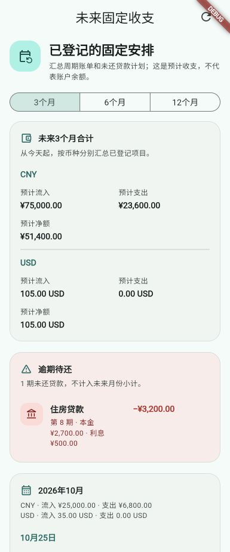

# 第43轮验收：未来固定收支一览

## 交付内容

从记账首页“更多操作”进入独立页面，按3、6或12个自然月查看已启用周期账单和未还贷款计划。周期账单按规则周期稳定 UUID 排除已生成项目；逾期贷款单独显示；金额按币种分别统计。页面只读本地已有数据，不写业务记录、不执行自动记账，也不推算账户余额。

实现还补充了批量查询已生成账单 UUID、月末与规则日期范围复用、错误重试和页面恢复刷新。财务功能文档及本轮方案已更新。

## 验收结果

- 新增未来固定收支服务、SQLite 只读查询和页面导航：10项新增服务、存储及页面测试通过。
- 首页入口导航测试通过。
- 财务回归测试通过：174项，覆盖周期自动化、重复账单、贷款原子性和财务 schema。
- `flutter analyze`：通过，无问题。
- `flutter build web --release`：通过。
- `git diff --check`：通过。
- 自动化测试验证了月度范围、币种分组、材料化周期去重、逾期贷款过滤、无写入读取以及页面入口和状态呈现。

## 界面证据

使用本地预览和虚构示例数据检查了手机布局、币种汇总、逾期待还和月份分组。此图不是用户财务数据。预览右上角保留 Flutter Debug 标记。

浏览器中已登录的应用页面受到登录/CAPTCHA 阻挡，因此本轮没有完成已登录账户下的真实数据浏览器验收；Web release 构建成功不代表该在线流程已验证。

## 边界

页面不纳入手工录入的未来账单，不预测实际扣款、未来账户余额或银行余额。周期账单与贷款计划表达的是用户已登记的安排。页面和统计口径只覆盖这些来源。
