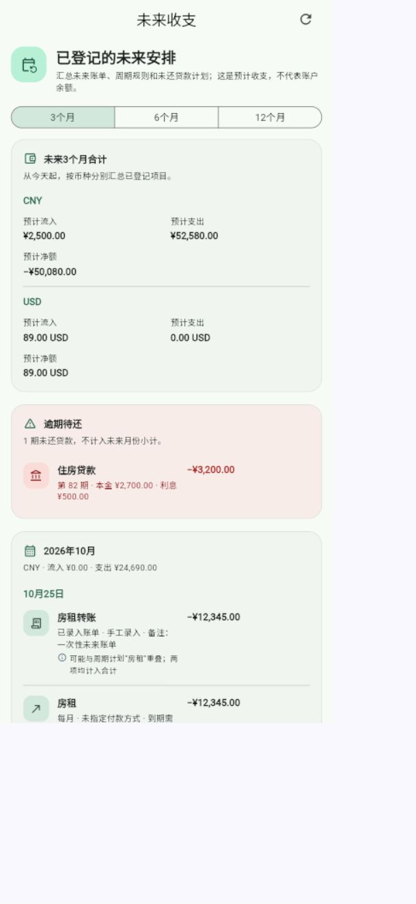
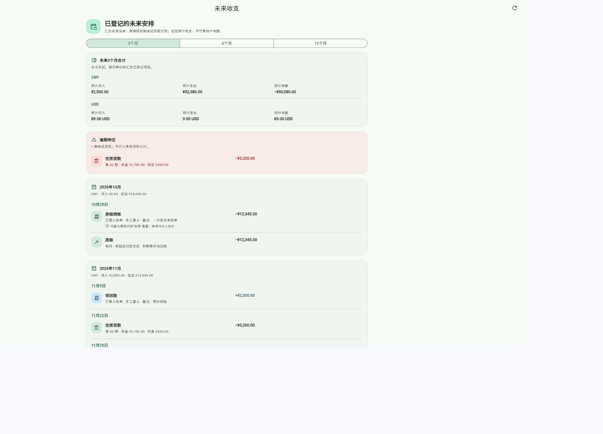

# 第44轮验收：未来手工账单纳入收支一览

状态：**已实施并完成本地验收；等待用户验收确认。**

## 实现结果

- “未来收支”现在合并显示未来日期账单、启用的周期规则和未还贷款期次，并按月、按币种统计。
- 今天的手工账单只有在账本记录的发生时刻晚于当前时刻时显示；判断使用账单保存的时区。未来日期账单按账单日显示，已删除和范围外账单排除。
- 已生成的周期账单以真实账单行呈现；周期规则预测行不会重复计入。
- 手工账单与周期规则或贷款期次在日期、币种、金额和流入／流出方向都相同时，会显示“可能重叠”提示。候选记录不会被合并或删除，页面明确说明两项仍分别计入金额。
- 点手工账单可打开现有详情页；从详情返回后重新加载金额与列表。没有新增数据库字段、迁移或同步协议。
- 由于页面现在包含一次性账单，入口和页面标题从“未来固定收支”调整为“未来收支”。

## 验收结果

- 新增未来收支 service、SQLite 和页面定向测试：**14项通过**，覆盖日期及保存时区边界、收入和退款、多币种、可能重叠但不去重、已生成周期 UUID、软删除、只读读取、详情导航和返回刷新。
- 记账首页入口测试：**1项通过**。
- 周期自动化、周期回归、贷款原子性和财务 schema 测试：**174项通过**。
- `flutter analyze`：通过，无问题。
- `flutter build web --release`：通过。
- `git -c core.fsmonitor=false diff --check`：通过。

## 界面证据

以下截图来自本地浏览器预览，使用虚构的示例账单和贷款数据；没有展示或读取真实财务账户。手机尺寸图展示摘要、逾期提醒、手工账单及重叠标记；桌面图展示相同列表的宽屏布局。

本轮验证了本地 fixture 页面和 Web release 编译，没有验证登录账户下的线上页面或银行实时余额。

## 已知边界

“可能重叠”是按字段完全相同产生的提示，不表示系统确认两条记录重复。页面不会擅自隐藏项目；用户应核对提示后决定是否编辑账单或计划。所有数值代表已登记安排，不代表账户余额或必然发生的扣款。
