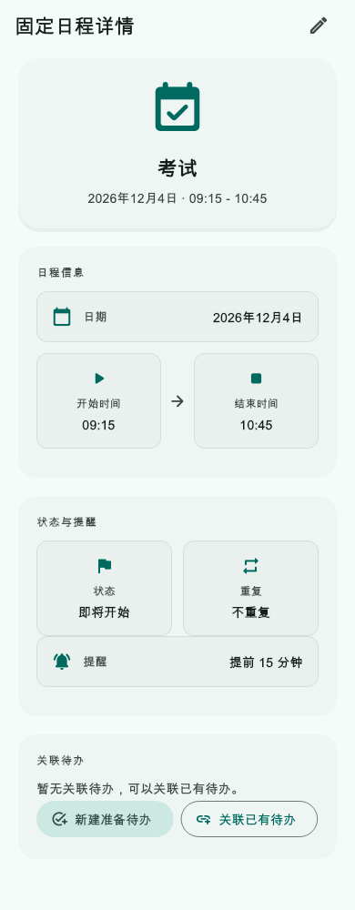
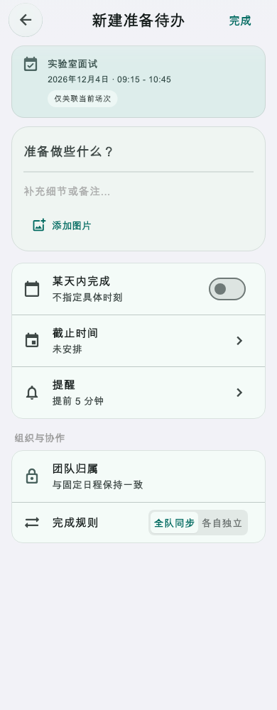
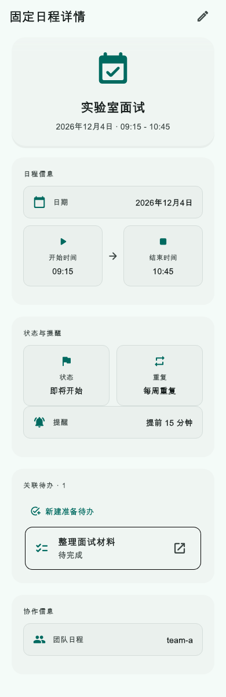
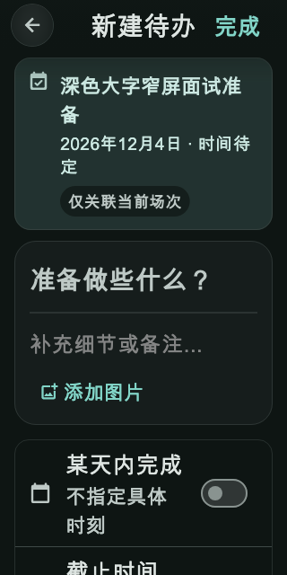

# 第41轮验收：固定日程详情直接新建关联待办

日期：2026-10-24（北京时间）

状态：**实现与技术验收完成，等待用户验收；尚未提交或推送**

## 本轮结果

- 固定日程详情在无关联待办和已有待办两种状态下均提供“新建准备待办”；“关联已有待办”保持原行为。取消场次不显示新建入口，冲突复核详情仍为只读。
- 从入口进入整页新建待办。表单展示当前固定日程标题、日期、时间和“仅关联当前场次”，标题初始为空、期限不自动推断；团队范围锁定为日程所属范围，待办不重复。
- 保存把新待办、当前场次的 `relatedTodoIds` 更新，以及待办/固定日程两条 op log 写进同一个 SQLite 事务。当前场次之外的重复日程实例不变；并发修改、切换账号、范围不符或任一写入失败时整笔回滚。
- 成功后详情即时显示关联待办，并触发现有同步、提醒、团队更新、共享快照、小组件与首页刷新流程；退出保护沿用新建待办已有逻辑。
- 规划语义已补充至 `docs/features/todo-semantics.md`。本轮没有服务端、schema 或部署改动。

## 自动化验证

| 验证项 | 结果 |
| --- | --- |
| 固定日程关联事务 + 详情页 Widget 测试 | 16 项通过：原子写入、快照失效、团队不匹配、取消场次、触发器失败回滚、退出保护、保存后展示、窄屏深色大字等 |
| 待办保存、固定日程模型/重复规则、冲突复核回归 | 48 项通过 |
| 合计定向回归 | 64 项通过；不是全仓完整测试套件 |
| 变更 Dart 源码与测试静态分析 | 20 个文件，`dart analyze` 无问题 |
| Dart 格式 | 20 个文件格式检查通过 |
| `git diff --check` | 通过 |
| Flutter Web release | `flutter build web --release --no-pub` 成功，生成本地 `build/web`；没有部署 |

测试通过 Flutter 临时 SDK wrapper 执行，以绕开只读 SDK 的缓存写入限制；WidgetTester 需要本机回环端口。测试和 Web 构建没有访问外部服务。

## UI 证据

以下图片由 Flutter WidgetTester 生成，不是真机或浏览器截图。常规手机画布约为 390 像素宽；深色大字画布为 320×640、文字缩放 1.6。深色大字模式会把过长的页面标题收短为“新建待办”，避免窄屏截断。

### 无关联项详情

### 新建上下文表单

### 保存后详情

### 深色、大字、窄屏

## 验收边界

- SQLite 事务、双 op log、并发快照、账号切换和回滚由自动化测试覆盖。提醒、团队信号、桌面小组件和首页更新复用了已有保存后流程，但本轮没有真实设备通知投递或多设备服务端同步验收。
- Web release 只验证编译，不代表已部署或已在用户数据上运行。
- 新增存储测试位于 `.gitignore` 忽略的 `test/services/` 下，四张本轮截图位于被忽略的 `test/widgets/goldens/`；用户确认通过后提交时需仅对这些准确路径使用强制添加。
- 工作区另有 Android、财务、引导/帮助和版本相关未提交改动；它们不属于本轮，保持原状。
- 按约定，待用户确认通过后只提交第41轮文件，不推送，然后准备第42轮方案。

## 模型执行说明

用户要求规划阶段使用 GPT‑6.1 sol／中、实现阶段使用 GPT‑6 luna／Max。当前执行环境没有切换或核验模型的入口，本报告不声称已切换模型或思考强度。
