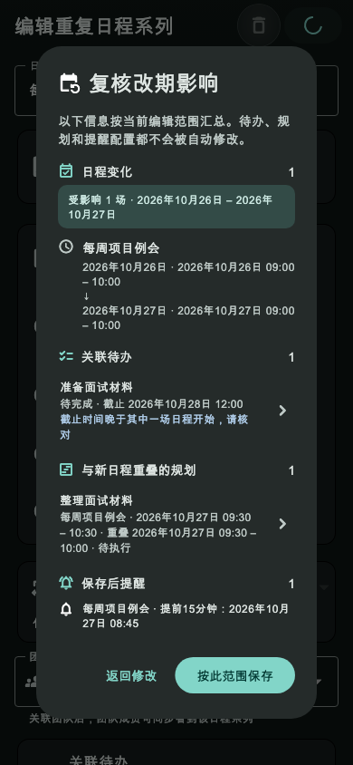
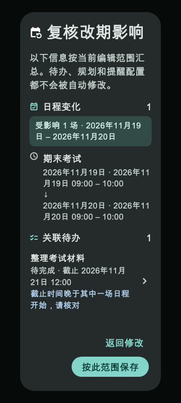
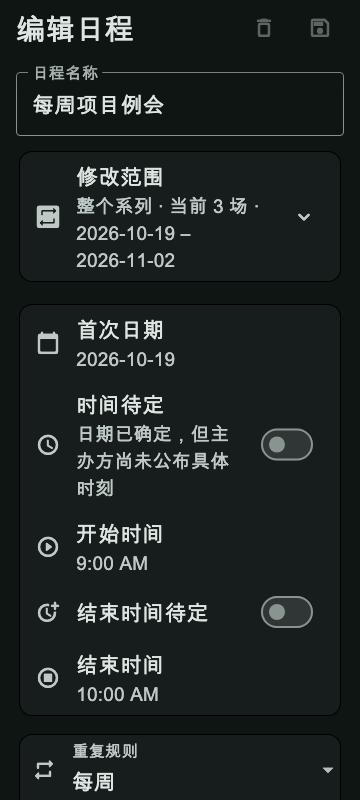

# 第39轮验收：固定日程改期后的关联事项复核

日期：2026-10-24（北京时间）

状态：**技术验收完成，待用户确认**

## 完成内容

- 固定日程改期后，按最终编辑范围显示受影响场次、改期前后时间、关联待办状态和期限、真实重叠的有效规划，以及按新时间计算的提醒。
- 已删除或当前范围不可见的待办标题不显示；团队日程只读取同团队待办。截止时间提示只要求核对，不把截止期限当成占用冲突。
- 用户可从复核页进入待办或规划详情。返回后重新读取数据；关联数据变化时刷新复核内容，保存仍需再次确认。
- 用户取消复核时不写入日程。确认后使用现有事务并发校验，按原有系列编辑语义取消旧场次并写入新场次。
- 修正了 SQL 待办提醒默认值 `-1` 与读取快照 `null` 的等价比较，避免正常改期被误判为关联待办已变化。
- 日程写入成功后，提醒重排在后台调用；重排错误只记录诊断，不把已提交的日程误报为保存失败。提醒注册仍由现有 `ReminderScheduleService` 管理。
- 窄屏大字号下，固定日程编辑器的重复规则和团队下拉框使用可用宽度，顶栏保留可触达的保存操作。

## 验收结果

| 检查 | 结果 |
| --- | --- |
| 定向回归 | 24 项通过，覆盖影响计算、存储并发保护、改期编辑流程及弹窗布局 |
| Flutter 静态分析 | 10 个变更 Dart 文件，无问题 |
| Dart 格式 | 变更文件格式检查通过 |
| Flutter Web release | 构建成功，`build/web` 生成 |
| Git 差异检查 | `git diff --check` 通过 |
| UI 截图 | 390×844 深色手机复核页；360×800 深色 1.35 倍文字复核页；360×800 深色大字号编辑器；桌面深色大字号范围选择 |

定向测试命令：

```bash
flutter test --no-pub \
  test/services/fixed_schedule_reschedule_impact_service_test.dart \
  test/services/fixed_schedule_edit_storage_test.dart \
  test/widgets/fixed_schedule_series_edit_test.dart \
  test/widgets/fixed_schedule_reschedule_impact_dialog_test.dart \
  --reporter compact
```

静态分析命令：

```bash
flutter analyze lib/screens/fixed_schedule_editor_screen.dart \
  lib/services/fixed_schedule_reschedule_impact_service.dart \
  lib/widgets/fixed_schedule_reschedule_impact_dialog.dart \
  lib/storage_service.dart lib/storage_service_contract.dart \
  lib/storage_service_fixed.dart \
  test/services/fixed_schedule_edit_storage_test.dart \
  test/services/fixed_schedule_reschedule_impact_service_test.dart \
  test/widgets/fixed_schedule_series_edit_test.dart \
  test/widgets/fixed_schedule_reschedule_impact_dialog_test.dart
```

## 图片证据

### 改期复核页：390×844 深色手机



### 深色大字号：360×800，文字缩放 1.35



### 窄屏编辑器保存入口：360×800，文字缩放 1.35



截图由 Flutter `WidgetTester` 生成；不是连接真实账号或手机系统提醒的运行截图。

## 尚未覆盖

- 未在真实手机上验证系统通知权限、通知触发和重启后的系统级投递。
- 未对在线服务或跨设备同步进行部署验证。本地并发快照与事务行为由定向存储测试覆盖。
- 工作区原有 Android 到课提醒改动保持未暂存、未提交；本轮尚未提交，也未 push。
- 当前环境没有切换或核验模型及思考强度的入口，因此不声称执行时已切换到 GPT‑6 luna／Max。

## 复核样例

自动化流程将重复日程的 2026-10-26 场次改到 2026-10-27。复核页显示原场次与新场次、关联待办“准备面试材料”的期限提示、与新时段重叠的规划“整理面试材料”，以及提前15分钟的 08:45 提醒。选择“返回修改”后原日期未变；再次确认保存后，原场次标为已取消，新场次写入 2026-10-27，提醒重排调用一次。
