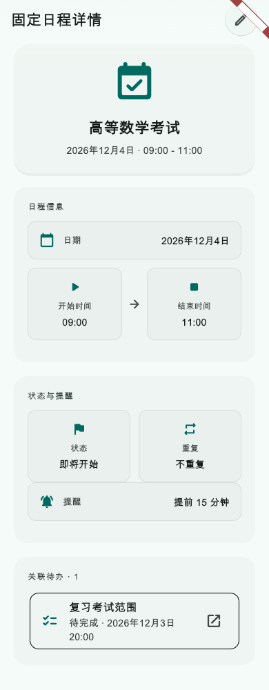
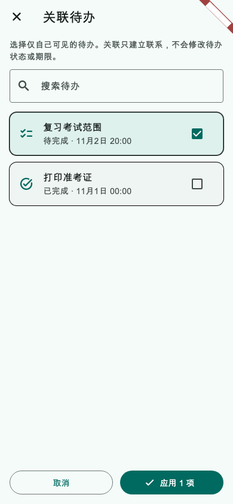

# 第37轮验收报告：固定日程与待办关联闭环

日期：2026-10-24（北京时间）

关联方案：[第37轮方案：固定日程与待办关联闭环](../proposals/2026-10-23-fixed-schedule-todo-relations.md)

状态：**验收通过；用户回复“请继续”，按既定工作流确认通过，准备提交本轮**

## 实施结果

- 固定日程详情增加关联待办列表，展示状态和日期；点击可访问的待办进入现有详情页，返回后重新读取最新状态。空列表、读取失败、已删除及不可访问的旧关系分别呈现；删除或跨可见范围的待办标题与状态不会泄露。
- 固定日程编辑器可进入独立多选页，支持搜索、状态和期限信息。完成或跳过的待办仍可关联；选择页“取消”丢弃暂存，“应用”只回填编辑草稿，主表单保存前不会写入关系。
- 保存关系变动前重新读取待办，确认项目仍存在、未删除且与日程个人／团队范围一致；读取失败或关系失效时阻止保存并保留草稿。
- 重复范围只有在用户实际改动关联列表时才应用关系变更。仅本次、本次及以后、整个系列分别按现有范围生效；未改关联时保留各场原有关联，新增场次继承当前模板关系。外部日历日程仍只编辑当前场次。
- 复用 `relatedTodoIds`、现有固定日程本地保存、并发快照校验与操作日志，没有增加字段、迁移或服务端改动。
- 更新待办与固定日程语义文档，并为 AI 创建的 `sourceTodoIds` 写入关系补充回归断言。

## 自动化验收

- 固定日程模型、重复生成、编辑范围、存储并发保护、AI 创建、详情页、选择页和编辑器集成回归：**103 项通过**。命令：

  ```sh
  flutter test --reporter compact \
    test/models/fixed_schedule_model_test.dart \
    test/services/fixed_schedule_recurrence_service_test.dart \
    test/services/fixed_schedule_edit_service_test.dart \
    test/services/fixed_schedule_edit_storage_test.dart \
    test/services/ai_todo_recurrence_alignment_test.dart \
    test/screens/fixed_schedule_detail_screen_test.dart \
    test/screens/fixed_schedule_related_todo_picker_screen_test.dart \
    test/widgets/fixed_schedule_series_edit_test.dart
  ```

- 测试覆盖关联加载失败后不保存、应用前后持久化隔离、已完成待办可选、搜索、团队可见范围、删除与不可访问占位，以及三种重复编辑范围的关系保留／传播。
- 指定的 14 个 Dart 实现与测试文件：`flutter analyze` **无问题**。
- 同一组 Dart 文件：`dart format --output=none --set-exit-if-changed` 通过；`git diff --check` 通过。
- Web release：`flutter build web --release --no-pub` 通过，生成 `build/web`。

## 图片证据

以下为生产详情页和待办选择页在 Flutter `WidgetTester` 中的截图，使用测试数据，不是实机或浏览器截图。详情页视口为 390 × 1000，选择页视口为 390 × 844；另有 320 × 720、深色主题及 1.4 倍字号的无溢出交互检查通过。





## 边界与提交

- 本轮未运行全仓 `flutter test` 或 `flutter analyze`；结果仅覆盖上列固定日程关联及相关回归文件。未做真实设备、浏览器账号、多设备同步或在线服务验收。
- 当前会话无法切换或核验模型，因此不能确认实际执行使用 GPT‑6 luna／Max。
- 用户于2026-10-24回复“请继续”。结合本轮既定流程，按验收通过处理。
- 本轮 commit 尚待创建；仅提交第37轮文件。Android 课程提醒相关原有工作区改动保持未暂存，不 push、不部署。
