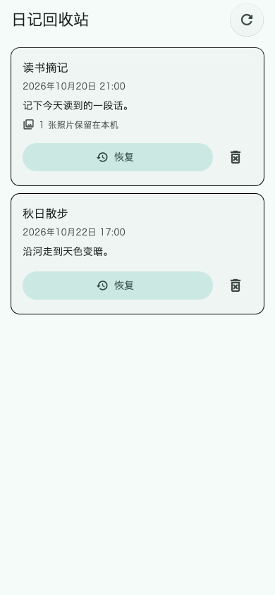
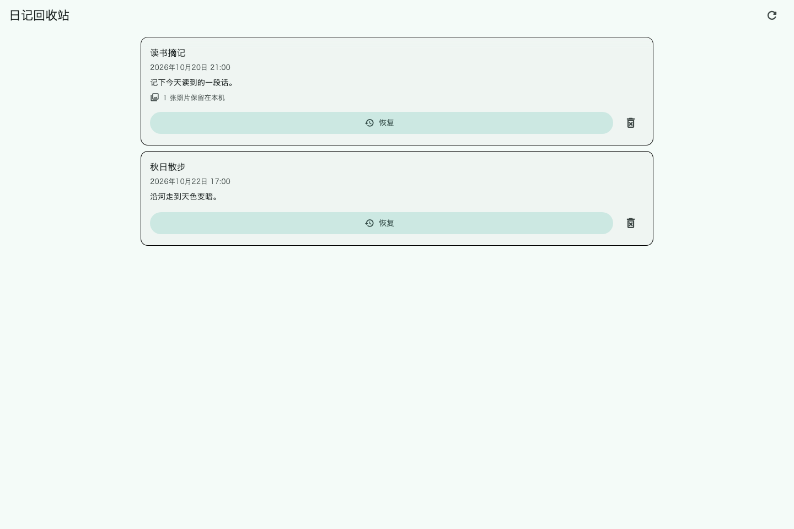
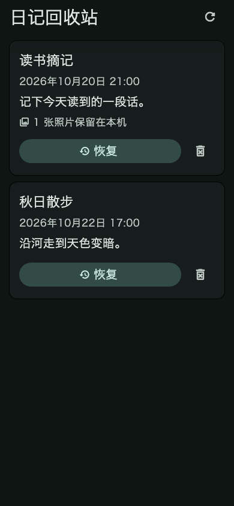

# 第47轮验收：私密日记回收站与照片保留恢复

日期：2026-10-24

状态：**实现与本地验收完成，等待用户验收；尚未提交 commit。**

## 交付内容

- 日记详情的“删除”改为“移至回收站”，确认提示说明文字和照片会留在本机。
- 日记首页新增回收站入口和数量徽标。移入后时间线立即刷新；回收站关闭后刷新时间线与数量。
- 新增独立回收站页面，按最近移入时间显示日记，可逐篇恢复或二次确认永久删除。
- 普通时间线和照片墙只查询未删除日记。回收站、恢复、永久删除都限定当前账号及对应 UUID。
- 移入和恢复只更新现有 `is_deleted` 状态并保留附件引用；永久删除才删除附件行和本地媒体文件。
- 编辑器保存前在事务内复核原日记仍存在且未删除，防止旧编辑页面把回收站日记重新写活。冲突时保留编辑内容并显示原因。
- 更新 [私密日记功能说明](../features/private-journal.md)。没有数据库迁移、云同步或服务端改动。

## 验收结果

- **11 项定向测试通过**：模型删除状态序列化；移入／恢复与 Web 图片数据保留；旧编辑器并发保存拒绝；限定条目永久删除；账号数据库隔离；详情确认取消与确认结果；回收站恢复、取消永久删除与确认永久删除；本地照片文件在确认前存在、确认后删除；首页数量入口和导航；原日记空白搜索回归。
- **目标文件静态分析通过**：覆盖本轮六个日记实现文件和五个相关测试文件，`No issues found`。
- **Web release 构建通过**：`flutter build web --release --no-pub`，生成 `build/web`。Flutter 的 WASM dry-run 成功；输出的可选 WASM 建议不影响构建。
- **格式与差异检查通过**：本轮 Dart 文件已格式化；`git diff --check` 通过。
- **视觉证据已人工检查**：Flutter WidgetTester 输出，使用系统 CJK 字体和 Material 图标字体；包含手机、桌面及深色大字布局。它们不是实际设备截图。

## 截图

### 手机

### 桌面

### 深色与大字

## 验收边界

- 本轮运行了日记相关定向测试，没有运行完整 Flutter 测试套件。
- Web release 构建成功，但未部署；没有连接真实用户数据库或真实设备进行现场验收。
- 工作区还有其他预先存在的修改，本轮不包含这些改动，也不会在用户验收前提交。
