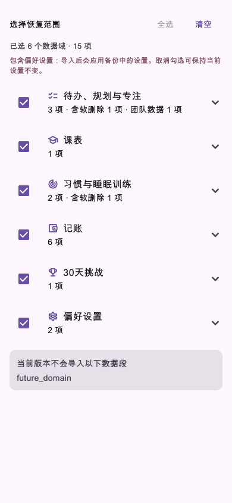
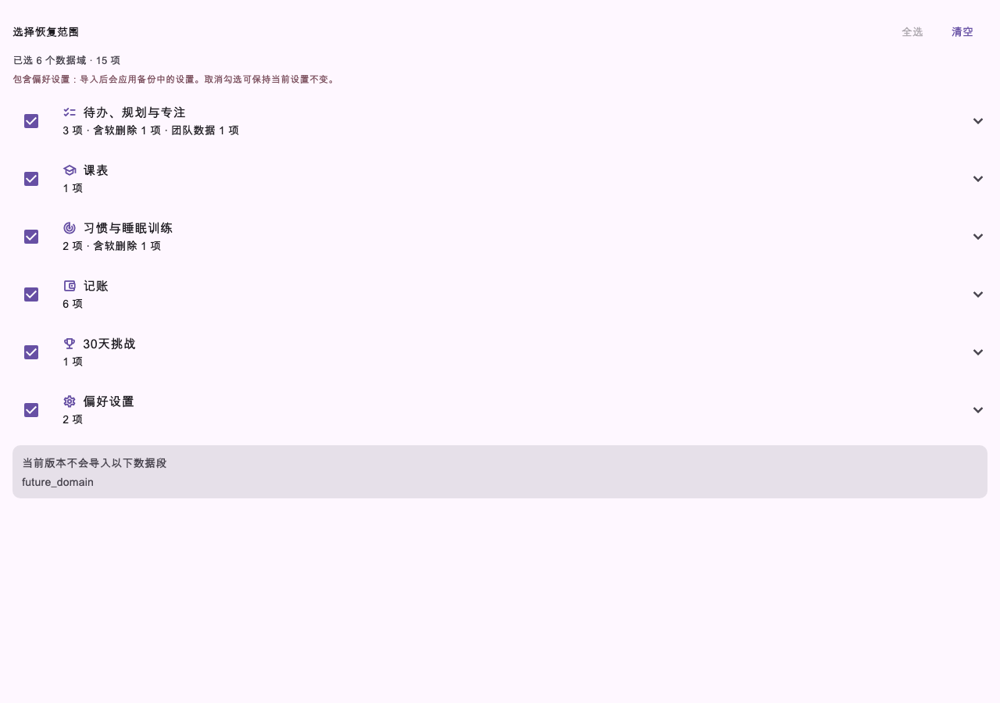
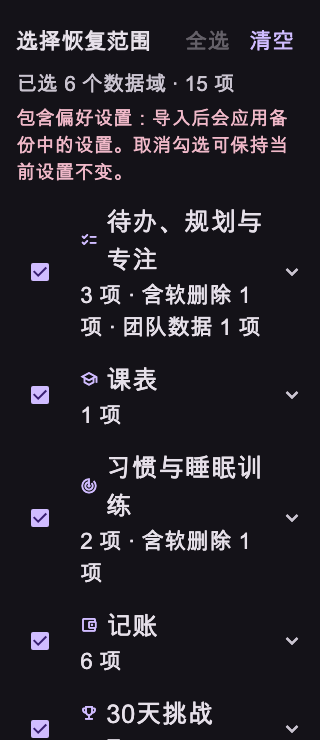

# 第45轮验收：备份按数据域选择恢复

日期：2026-10-24（北京时间）

状态：**用户验收通过；已提交（未推送）**

## 实现结果

- 导入预览按待办／规划／专注、课表、习惯／睡眠训练、记账、30天挑战和偏好设置分组；文件中存在的支持域默认选中。
- 支持全选和清空；清空后导入按钮禁用，服务 API 也拒绝空范围。
- 展示每个范围的归档条目数量、软删除数量和团队数据数量；记账计数包含分类与付款方式。
- 未知数据段会明确显示为当前版本不会导入，并在导入筛选中排除。
- 只把已选数据域交给现有导入器；保留既有 UUID、团队数据、回滚和域内导入行为。提醒刷新仅在所选内容涉及相应提醒域时执行。偏好设置会单独提示。
- 更新 [数据备份与恢复说明](../features/data-backup.md)，记录挑战状态和偏好设置沿用现有导入器语义，避免将各数据域描述成同一种合并方式。

## 界面证据

以下是恢复范围选择控件的 Flutter widget 截图，使用同一份合成备份预览数据：

### 手机

### 桌面

### 深色与大字号

这些截图验证范围选择控件的显示和布局，不代表真实账号备份导入后的数据库内容。

## 验收命令

- 定向测试：
  `flutter test test/services/data_import_selective_restore_test.dart test/widgets/import_scope_selector_test.dart test/services/data_import_fixed_schedule_preview_test.dart` — **14 项通过**。
- 静态分析：`flutter analyze` — **通过，无问题**。
- Dart 格式：对本轮 6 个 Dart 文件执行 `dart format --output=none --set-exit-if-changed` — **通过，0 个文件需要格式化**。
- Web release：`flutter build web --release` — **通过，生成 `build/web`**。Wasm dry-run 成功。
- 空白检查：`git diff --check` — **通过**。

Flutter 命令在受限环境中首次启动时无法写 SDK 缓存，随后在授权的本地验收上下文中重试并通过。

## 验收边界

- 未运行完整 `flutter test` 全量套件，也未使用真实用户账号执行端到端导入。
- 定向测试覆盖数据域归组和计数、所选数据段筛选、默认全支持域兼容、空选择拒绝、范围切换、清空／全选、窄屏大字号布局，以及既有固定日程和挑战预览边界。
- Round45 commit 仅包含本轮 13 个文件；没有推送，也没有纳入工作区其他改动。
