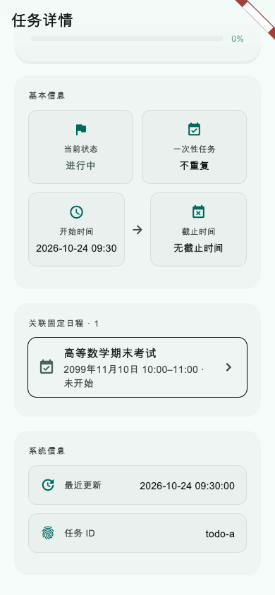
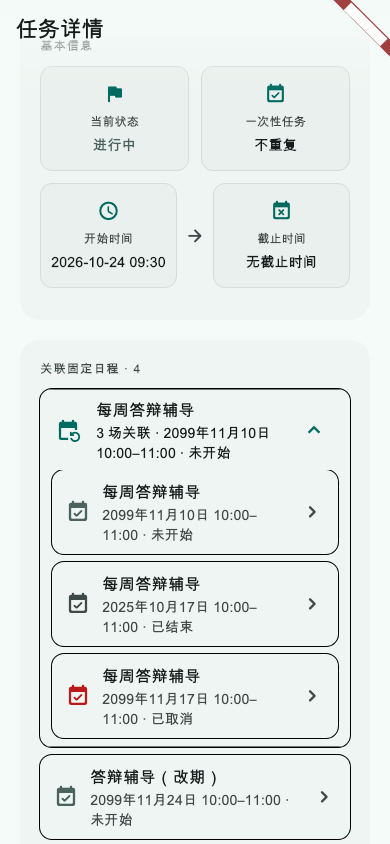

# 第38轮验收报告：待办详情反向查看关联固定日程

日期：2026-10-24（北京时间）

关联方案：[第38轮方案：待办详情反向查看关联固定日程](../proposals/2026-10-24-todo-detail-fixed-schedule-context.md)

状态：**用户已确认验收通过；本轮提交进行中**

## 实施结果

- 待办详情新增只读“关联固定日程”区，可从单次日程或重复系列中的具体场次进入现有固定日程详情；返回后重新读取关系。
- 新增账号范围内的存储查询，按 JSON ID 精确匹配非删除日程，并让数据库／解码错误传播，页面可以分开显示加载中、确认为空和读取失败。
- 关系展示再次校验待办 ID 与可见范围：个人待办只匹配个人日程，团队待办只匹配相同团队。软删除项不显示；已结束和已取消的历史项仍保留。
- 重复日程按系列 ID 与标题归组，避免标题被单场改动后误合并。摘要优先选进行中或最近未来场次；没有可用未来场次时显示最近历史场次；展开后逐场显示日期、时间、状态和地点。
- 账号变更会清空旧账号标题；慢响应按请求序号和当前账号快照丢弃。页面监听固定日程刷新信号、恢复前台及从详情返回时刷新。
- 固定日程详情到待办详情的现有导航现已覆盖反向入口回归；未新增待办外键、数据库迁移、同步协议、服务端接口或网络读取。

## 自动化验收

- 固定日程模型、重复展开、范围编辑与本地存储、AI 关系写入、原关联待办选择／详情、反向关系筛选与详情 UI 回归：**114 项通过**。本次定向命令覆盖以下测试文件：

  ```sh
  flutter test --no-pub --reporter expanded \
    test/models/fixed_schedule_model_test.dart \
    test/services/fixed_schedule_recurrence_service_test.dart \
    test/services/fixed_schedule_edit_service_test.dart \
    test/services/fixed_schedule_edit_storage_test.dart \
    test/services/fixed_schedule_related_todo_storage_test.dart \
    test/services/fixed_schedule_todo_relation_service_test.dart \
    test/services/ai_todo_recurrence_alignment_test.dart \
    test/screens/fixed_schedule_detail_screen_test.dart \
    test/screens/fixed_schedule_related_todo_picker_screen_test.dart \
    test/screens/todo_detail_related_fixed_schedules_test.dart \
    test/widgets/fixed_schedule_series_edit_test.dart
  ```

- 回归包括个人／团队隔离、同 ID 精确查询及删除过滤、重复场次分组和标题差异、读取失败重试、固定日程详情往返刷新、固定日程数据通知刷新、账号切换期间丢弃旧响应、窄屏深色 1.4 倍字号无布局溢出。
- 变更涉及的 12 个 Dart 源码与测试文件：`flutter analyze` **无问题**。
- 同组 Dart 文件：`dart format --output=none --set-exit-if-changed` 通过；`git diff --check` 通过。
- Flutter Web release：`flutter build web --release --no-pub` 通过，耗时约70秒，生成 `build/web`。

## 图片证据

以下图片由 Flutter `WidgetTester` 从待办详情实际组件生成，视口为 390 × 844；不是实机或浏览器截图。图中日期与待办时间固定，确保回归金图可重复。





另以 320 × 720、深色主题、1.4 倍字号运行布局检查；没有 RenderFlex 溢出。

## 边界与提交

- 本轮未运行全仓 `flutter test` 或 `flutter analyze`；上述结果只覆盖所列固定日程、关联待办和详情页回归。
- 未做真实设备、浏览器登录流程、多设备同步或在线服务验收。Web release 构建只证明编译成功，不代表已部署。
- 当前会话没有模型切换或核验入口，不能确认实际使用 GPT‑6 luna／Max。
- 用户于2026-10-24确认本轮验收通过；仅提交第38轮文件。Android 到课提醒相关的 `AndroidManifest.xml`、`MainActivity.kt`、`ReminderService.kt` 和 `CourseArrivalReceiver.kt` 保持未暂存／未提交；不 push、不部署。
